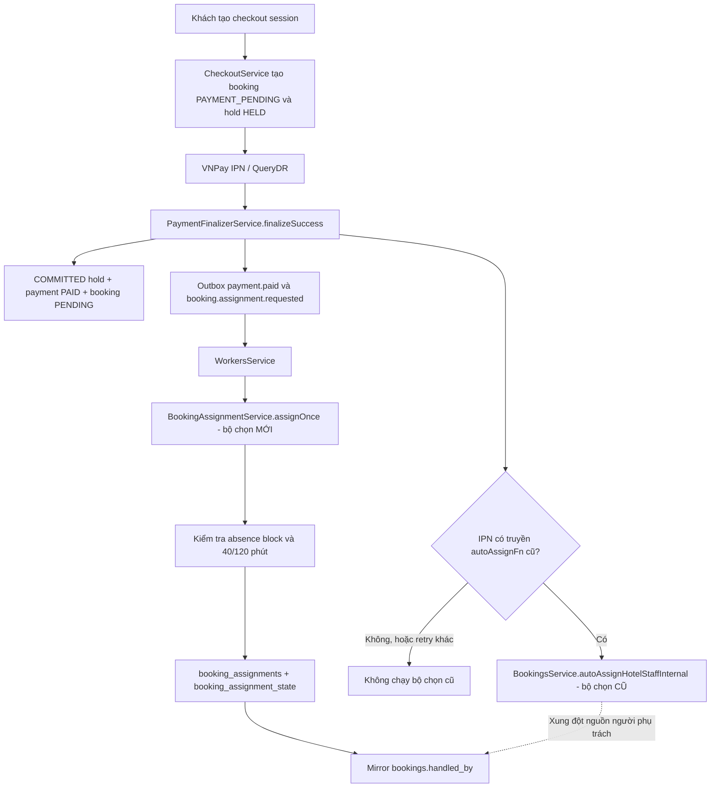
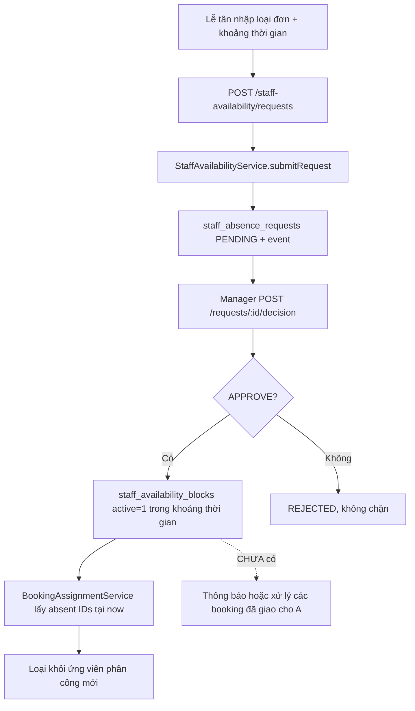
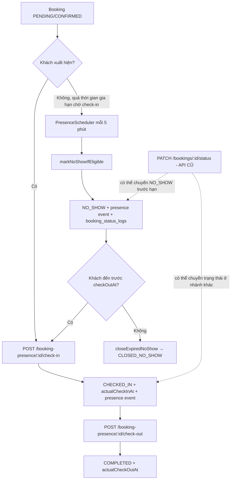
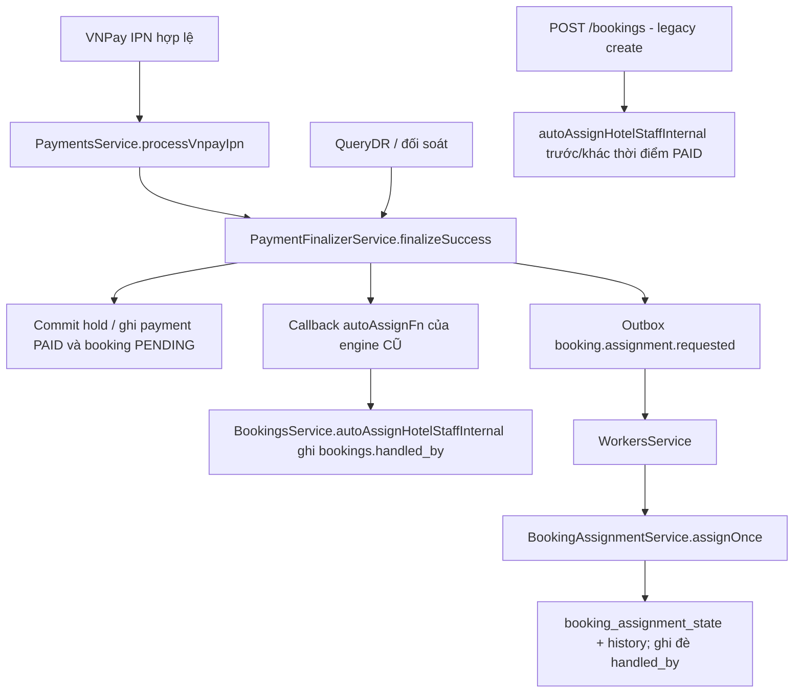
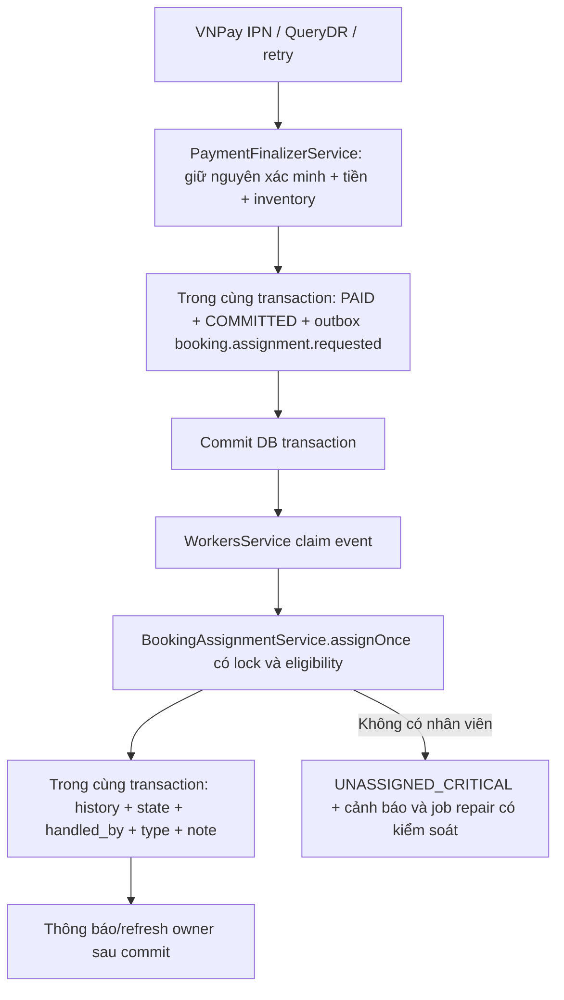
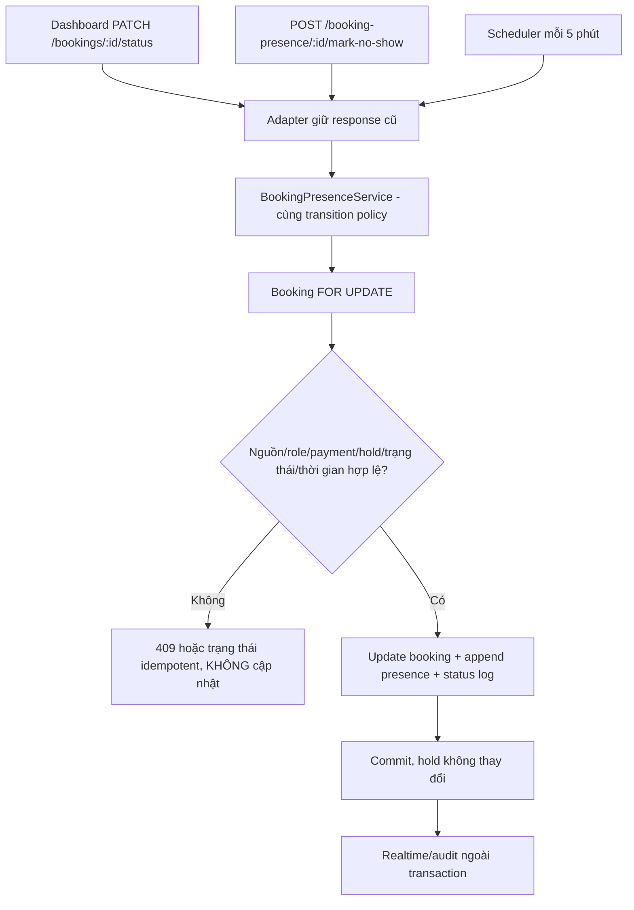

# TRAVELEKE — BÁO CÁO KIỂM TRA SOURCE CODE ĐỢT 1 & ĐỢT 2


**CẬP NHẬT 28/10/2026 — BẢN V2:** Bổ sung hướng sửa có kiểm soát cho 5 nhóm lỗi được yêu cầu, kịch bản dữ liệu trước/sau, kiến trúc adapter single-writer, cách duy trì API cũ, danh sách file được phép đụng, test hồi quy và lệnh SQL chỉ đọc. Nội dung kiểm tra 50 mục cũ được giữ lại phía dưới; chi tiết triển khai mới bắt đầu ở **Mục 15**.

## 0. Chốt phiên bản source đã đọc và mức tin cậy

| Repository | Branch / commit cố định | Phạm vi quan sát |
|---|---|---|
| Backend: [cg_traveleke_service](https://github.com/HuuTri331/cg_traveleke_service/tree/minh) | `minh` — `0bfcc021dbe1f224967e51e4a221d3f48cd26723` | Các module mới, service điều phối, thanh toán, inventory, booking cũ, schema/migration, test liên quan. Cây repo có 388 mục. |
| Frontend: [cg_traveleke_app](https://github.com/HuuTri331/cg_traveleke_app/tree/minh) | `minh` — `e1597a978558b24808f50954907d68e194988fd2` | API clients, dashboard booking, quản lý đơn nghỉ, khách báo đến muộn, loại phòng và điều hướng. Cây repo có 245 mục. |

Các commit mới tương ứng một đợt thay đổi lớn so với lần kiểm tra trước. Có test đơn vị mới cho `assignment-policy`, `staff-availability` và `booking-presence`; nhưng tại hai commit **không có GitHub Actions workflow run hoặc commit status được trả về**. Không suy diễn là test đã chạy và pass. Môi trường kiểm tra không truy cập được GitHub từ container để clone/chạy `npm test`, không có DB/vé thanh toán thật; các nhận định dưới đây là **lỗi đã được chứng minh bằng đường code**, **rủi ro có điều kiện**, hoặc **khoảng trống kiểm thử**, phân loại riêng.

**Quy ước mức độ:** `P0` = phải xử lý trước khi cho dữ liệu/thanh toán thực đi qua; `P1` = lỗi quan trọng cần xử lý trong hai đợt; `P2` = hoàn thiện chất lượng, hiệu năng hoặc UX. `XÁC NHẬN` = đã thấy đường code trực tiếp; `ĐIỀU KIỆN` = xảy ra nếu DB/trạng thái/luồng vận hành đáp ứng điều kiện nêu rõ; `CHƯA CHẠY THỬ` = không có bằng chứng runtime.

### Kết luận nhanh

**Đợt 1: đã có cấu trúc, chưa khép kín.** Đã có đơn nghỉ/đi muộn, quản lý duyệt, block không khả dụng, chính sách 40/120 phút, phân công có lịch sử, worker nhận outbox và giao diện. Tuy nhiên tồn tại đường phân công kép cũ/mới, API phân công thiếu quyền, chưa xác minh PAID + COMMITTED, dữ liệu lịch sử không đồng bộ sau reassign và nhiều nhánh tranh chấp.

**Đợt 2: đã có cấu trúc, còn lỗi cản trở luồng tự động.** Đã có trạng thái No-show/Closed No-show, check-in muộn, lịch sử hiện diện, scheduler và giao diện. Nhưng `changedBy='0'` xung đột FK có thể làm scheduler rollback; các endpoint No-show/hiện diện thiếu guard hoặc bỏ qua điều kiện; `updateStatus` cũ là cửa sau khiến No-show xảy ra trước hạn, đồng thời không khóa booking như service mới.

**Không được triển khai lên môi trường có đơn đặt/tiền thật trước khi sửa nhóm P0 và chạy tích hợp.** Những phần cũ không liên quan phải giữ nguyên; khi sửa chỉ thay phần giao nhau và cần có regression test.

### Quy ước thuật ngữ được thống nhất trong bản V2

- **Thời gian gia hạn chờ nhận phòng trước khi chuyển No-show:** khoảng thời gian chờ tính từ `bookings.check_in_at`, mặc định 360 phút (6 giờ) khi cấu hình `no_show_grace_minutes` chưa thay đổi. Tên biến **`noShowGraceMinutes` giữ nguyên** để không phá API/schema. Đây là tên hiển thị cho người dùng, không phải quy tắc kéo dài ngày trả phòng.
- **Gia hạn kỳ lưu trú:** thay đổi `check_out_at`/giữ phòng/giá nếu có phê duyệt; **khác hoàn toàn** với khoảng chờ trước No-show. Đợt sửa lỗi này **không triển khai** thay đổi kỳ lưu trú.
- Khi đã thành `NO_SHOW`, booking VNPay **vẫn giữ `booking_holds.status='COMMITTED'`** đến hết khoảng đặt, khách vẫn có thể làm thủ tục `NO_SHOW → CHECKED_IN` trước `check_out_at`.
- `P0-01..P0-10` là ID lỗi kiểm tra, **không phải** trạng thái PR đã được sửa. Bản V2 chỉ viết hướng sửa, chưa commit lên source.

## 1. Bản đồ luồng *thực tế đang tồn tại*

### 1.1. Đợt 1 — sau thanh toán VNPay



**Vấn đề:** `payment-finalizer.service.ts` vẫn hỗ trợ callback phân công cũ, và `payments.service.ts` vẫn truyền callback đó khi IPN thành công; trong lúc cùng `finalizeSuccess()` cũng ghi `booking.assignment.requested` cho worker mới. Đó là hai đường riêng không cùng một nguồn sự thật. [Backend `payments.service.ts` L165–182](https://github.com/HuuTri331/cg_traveleke_service/blob/0bfcc021dbe1f224967e51e4a221d3f48cd26723/backend/src/payments/payments.service.ts#L165-L182), [finalizer L216–266](https://github.com/HuuTri331/cg_traveleke_service/blob/0bfcc021dbe1f224967e51e4a221d3f48cd26723/backend/src/payments/services/payment-finalizer.service.ts#L216-L266).

### 1.2. Đợt 1 — đơn xin nghỉ/đi muộn



**Đã nối đúng:** quyết định duyệt và tạo block được bao bởi transaction. **Chưa nối đủ:** không có quy trình rà soát và chuyển các booking đã giao khi A được duyệt nghỉ. Đây là điểm giao với Đợt 3, cần có ít nhất cảnh báo từ Đợt 1.

### 1.3. Đợt 2 — check-in, no-show, checkout



Cả hai đường `booking-presence` và `bookings/:id/status` đang tồn tại. Đường mới có transaction khóa booking ở các điểm check-in/No-show; đường cũ không dùng cùng cơ chế khóa/trình tự kiểm tra thời gian, nên cần thống nhất nguồn thực hiện chuyển trạng thái.

## 2. DANH MỤC LỖI P0 — PHẢI SỬA TRƯỚC KHI PHÁT HÀNH

### P0-01 — Job No-show có thể rollback trên DB bật FK vì ghi actor hệ thống bằng ID `0` (`XÁC NHẬN / ĐIỀU KIỆN FK`)

- **Source:** [`booking-presence.service.ts` L438–445](https://github.com/HuuTri331/cg_traveleke_service/blob/0bfcc021dbe1f224967e51e4a221d3f48cd26723/backend/src/booking-presence/booking-presence.service.ts#L438-L445), L514–521; [`phase-2-unified-complete.sql` L504–520](https://github.com/HuuTri331/cg_traveleke_service/blob/0bfcc021dbe1f224967e51e4a221d3f48cd26723/database/bootstrap/phase-2-unified-complete.sql#L504-L520).
- **Code thực tế:** scheduler gọi `markNoShowIfEligible()`, cập nhật `bookings.status = NO_SHOW`, ghi `booking_presence_events` rồi ghi `BookingStatusLog` với `changedBy: '0'`. `closeExpiredNoShow()` cũng tương tự. Bảng `booking_status_logs.changed_by` có FK đến `users(id)`, cho phép NULL **nhưng không mặc định chấp nhận số 0**.
- **Tái hiện:** chạy scheduler cho booking đã PAID, hết thời gian gia hạn chờ check-in; nếu DB không có `users.id=0`, lệnh lưu log vi phạm FK, toàn bộ transaction rollback. Booking không sang No-show; job lặp lại sau 5 phút và lặp lỗi.
- **Nguyên nhân:** nhầm lẫn “SYSTEM actor” với một user ID giả. Migration đã sửa `changed_by` cho nullable, nhưng code không sử dụng NULL.
- **Sửa chính xác:** đổi `changedBy: null`, thêm `actorType: 'SYSTEM'` trong entity `BookingStatusLog`, hoặc tách `system_actor` bằng cột rõ ràng; không tạo tài khoản user 0 để lách FK. Sửa cả hai hàm tự động. Thêm test integration MySQL với FK bật, assert 1 lần chuyển trạng thái + 1 log + 1 presence event, không có user 0.
- **Không được làm:** bỏ FK, tắt `FOREIGN_KEY_CHECKS` ở runtime, hoặc bắt lỗi log rồi vẫn chấp nhận trạng thái đã cập nhật nửa chừng.

### P0-02 — Các endpoint phân công mới cho phép bất kỳ tài khoản đăng nhập nào đọc và kích hoạt phân công (`XÁC NHẬN`)

- **Source:** [`booking-assignment.controller.ts` L13–59](https://github.com/HuuTri331/cg_traveleke_service/blob/0bfcc021dbe1f224967e51e4a221d3f48cd26723/backend/src/booking-assignment/booking-assignment.controller.ts#L13-L59).
- **Code thực tế:** class chỉ gắn `JwtAuthGuard`, không có `RolesGuard` hoặc phép kiểm tra quan hệ khách sạn/booking trong `getHistory`, `triggerAssignment`, `repairUnassigned`. Người có role `CUSTOMER` nhưng đã đăng nhập có thể gọi `GET /booking-assignments/{bookingId}/history`, `POST /booking-assignments/{bookingId}/assign`, `POST /booking-assignments/repair`.
- **Hậu quả:** lộ danh tính/email nhân viên được giao thuộc khách sạn khác; khách bất kỳ kích hoạt job sửa phân công, tạo lịch sử không cần thiết và tiêu thụ tài nguyên. Nghiêm trọng hơn do `assignOnce` thiếu kiểm tra trạng thái thanh toán (P0-03).
- **Sửa chính xác:** controller truyền `@CurrentUser()` vào service; `history` chỉ cho khách của booking hoặc nhân viên có quyền hợp lệ thuộc hotel; `assign`/`repair` chỉ cho quản lý đúng hotel hoặc admin kỹ thuật; `repair` nên là worker/nội bộ chứ không mở HTTP rộng. Kiểm tra quyền **trên server sau khi lấy booking**, không dựa vào ẩn nút trên frontend. `MANUAL_TRIGGER as any` phải bỏ, dùng enum command hợp lệ.
- **Test:** customer A không xem được booking B; lễ tân hotel 1 không xem/trigger hotel 2; manager hotel 1 quản lý đúng hotel 1; anonymous 401.

### P0-03 — `assignOnce()` không kiểm tra booking đã PAID và hold đã COMMITTED (`XÁC NHẬN`)

- **Source:** [`booking-assignment.service.ts` L50–110 và L218–348](https://github.com/HuuTri331/cg_traveleke_service/blob/0bfcc021dbe1f224967e51e4a221d3f48cd26723/backend/src/booking-assignment/booking-assignment.service.ts#L50-L110); controller ở P0-02.
- **Code thực tế:** `assignOnce(bookingId)` khóa booking, xem `booking_assignment_state`, khóa khách sạn rồi chọn người; **không có điều kiện `payment_transactions.status='PAID'` và `booking_holds.status='COMMITTED'`; không kiểm tra trạng thái `PAYMENT_PENDING`, `CANCELLED`, `PAYMENT_REVIEW`, `PAYMENT_EXPIRED`, v.v.**
- **Tái hiện:** khách đang ở checkout nhưng chưa thanh toán; một tài khoản đăng nhập gọi `/booking-assignments/{id}/assign`, hệ thống vẫn có thể ghi nhân viên và state `ASSIGNED`. Booking hủy hoặc cần hoàn tiền cũng có thể bị gán nếu chưa có state.
- **Sửa chính xác:** trong transaction, trước mọi quyết định, khóa booking và xác minh chính sách: `booking.status IN ('PENDING','CONFIRMED',...)`, payment đã PAID và reservation inventory hợp lệ; phân biệt đơn `FRONT_DESK` nếu hỗ trợ tiền mặt/đơn trực tiếp, không suy diễn tất cả CONFIRMED đều đã VNPay. Trạng thái hủy/refund/payment-review phải skip có mã lý do; không cập nhật `handled_by` khi skip. Áp dụng cả worker, HTTP và repair.
- **Test:** PAYMENT_PENDING/FAILED/REVIEW/CANCELLED bị từ chối; PAID+COMMITTED được giao đúng một lần; booking frontdesk theo chính sách riêng.

### P0-04 — VNPay vẫn phân công bằng engine cũ rồi worker tiếp tục phân công engine mới (`XÁC NHẬN`)

- **Source:** [`payments.service.ts` L165–182](https://github.com/HuuTri331/cg_traveleke_service/blob/0bfcc021dbe1f224967e51e4a221d3f48cd26723/backend/src/payments/payments.service.ts#L165-L182), [`payment-finalizer.service.ts` L232–266](https://github.com/HuuTri331/cg_traveleke_service/blob/0bfcc021dbe1f224967e51e4a221d3f48cd26723/backend/src/payments/services/payment-finalizer.service.ts#L232-L266), [`bookings.service.ts` L411–538](https://github.com/HuuTri331/cg_traveleke_service/blob/0bfcc021dbe1f224967e51e4a221d3f48cd26723/backend/src/bookings/bookings.service.ts#L411-L538).
- **Luồng lỗi:** IPN → finalizer gọi callback cũ → `autoAssignHotelStaffInternal` chọn người theo VIP/normal, không có 40/120 phút → ghi `bookings.handled_by`, `assignment_type`, `assignment_note`; finalizer còn ghi outbox `booking.assignment.requested` → worker chạy `assignOnce` và chọn người có thể khác → ghi `booking_assignment_state` và đổi **chỉ `bookings.handled_by`**. `assignment_note`/`assignment_type` vẫn phản ánh người/mô hình cũ.
- **Tác động:** khách/manager thấy người A ở thông báo cũ, trạng thái mới là B; luồng 40 phút có thể bị vi phạm về mặt giao việc thực tế; lịch sử không đầy đủ, thống kê khó truy vết. Luồng đối soát VNPay lại không truyền callback cũ nên hành vi giữa IPN và reconciliation không giống nhau.
- **Sửa chính xác:** giữ nguyên toàn bộ commit hold, PAID, double-payment defense, refund và outbox; **bỏ việc gọi callback phân công cũ ở IPN** hoặc vô hiệu hóa callback khi feature mới bật. Chỉ tạo event outbox `booking.assignment.requested` sau PAID + COMMITTED; worker `assignOnce` là điểm ghi phân công chính duy nhất. Mirror đồng thời `handled_by`, `assignment_type`, `assignment_note`. Không gọi `assignOnce` transaction lồng bên trong transaction finalizer. Backfill các booking đã có `handled_by` trước khi bật mới để không ghi đè assignment thật.
- **Test:** IPN, QueryDR, retry, duplicate callback và delayed IPN phải cho cùng kết quả phân công, có đúng một state/receipt; không làm thay đổi refund/double-charge rules.

### P0-05 — No-show thủ công không ràng buộc đúng role, trạng thái nguồn hoặc trạng thái giữ phòng (`XÁC NHẬN`)

- **Source:** [`booking-presence.controller.ts` L110–124](https://github.com/HuuTri331/cg_traveleke_service/blob/0bfcc021dbe1f224967e51e4a221d3f48cd26723/backend/src/booking-presence/booking-presence.controller.ts#L110-L124), [`booking-presence.service.ts` L374–459](https://github.com/HuuTri331/cg_traveleke_service/blob/0bfcc021dbe1f224967e51e4a221d3f48cd26723/backend/src/booking-presence/booking-presence.service.ts#L374-L459).
- **Code:** `POST /booking-presence/:id/mark-no-show` gắn global `EMPLOYEE` hoặc `ADMIN` nhưng không chuyển actor đến service và không xác minh nhân viên thuộc hotel của booking, cũng không yêu cầu manager. Trong `markNoShowIfEligible`, hàm chỉ sớm bỏ qua một số trạng thái, sau đó khi quá thời gian gia hạn chờ check-in sẽ đổi các trạng thái **khác** sang `NO_SHOW`, không `if status NOT IN (PENDING,CONFIRMED) return/error`.
- **Tái hiện có điều kiện:** một nhân viên hotel A có ID booking hotel B gọi manual mark cho B; hoặc booking chưa hoàn tất thanh toán nhưng `checkInAt` đã qua grace → có thể chuyển sang NO_SHOW nếu tới được đường gọi này (sau khi sửa lỗi FK P0-01).
- **Sửa:** controller xác thực `@CurrentUser` và quyền MANAGER đúng hotel, service nhận `actor` + `source`; scheduler dùng entrypoint internal riêng. Tái kiểm tra dưới `FOR UPDATE`: chỉ `PENDING`/`CONFIRMED` **đã thanh toán hợp lệ**, chưa check-in, `now >= graceDeadline`, `now < checkOutAt`, giữ phòng hợp lệ, rồi mới đổi trạng thái. Không để `customReason` thay thế chứng cứ điều kiện thời gian.
- **Test:** user EMPLOYEE hotel khác 403, receptionist thường 403 nếu yêu cầu manager, PAYMENT_PENDING bị chặn, sau thời gian gia hạn chờ check-in mới No-show, hold không đổi.

### P0-06 — API trạng thái booking cũ cho phép gắn `NO_SHOW`/`CLOSED_NO_SHOW` không cần đạt điều kiện thời gian (`XÁC NHẬN`)

- **Source:** [`bookings.service.ts` L48–65 và L783–945](https://github.com/HuuTri331/cg_traveleke_service/blob/0bfcc021dbe1f224967e51e4a221d3f48cd26723/backend/src/bookings/bookings.service.ts#L783-L945), [`update-booking-status.dto.ts` L9–30](https://github.com/HuuTri331/cg_traveleke_service/blob/0bfcc021dbe1f224967e51e4a221d3f48cd26723/backend/src/bookings/dto/update-booking-status.dto.ts#L9-L30).
- **Code:** `VALID_STATUS_TRANSITIONS` nay cho `PENDING|CONFIRMED -> NO_SHOW`, `NO_SHOW -> CLOSED_NO_SHOW`. `PATCH /bookings/:id/status` chỉ kiểm tra trạng thái chuyển hợp lệ, **không kiểm tra `graceDeadline`, `now < checkOutAt`, `actualCheckInAt`, payment và hold** khi xử lý hai trạng thái mới. Có thể đánh dấu No-show ngay sau khi khách trả tiền, rồi đóng No-show ngay tiếp sau đó dù còn nhiều ngày.
- **Hậu quả:** doanh thu/báo cáo sai, khách đang còn quyền đến muộn nhưng bị hiển thị đóng booking; tạo lịch sử không thể tin cậy. Lệnh `updateStatus` còn không khóa dòng booking `pessimistic_write`, trái với scheduler và service mới.
- **Sửa an toàn:** route cũ vẫn giữ cho `CONFIRMED`, `CHECKED_IN`, `COMPLETED` để tương thích, **nhưng mọi lệnh liên quan No-show phải ủy quyền vào cùng một PresenceDomainService/transition policy** hoặc cấm các action mới ở endpoint cũ và chuyển frontend sang endpoint chuẩn. Không chỉ ẩn nút; backend phải từ chối. Thêm pessimistic lock hoặc optimistic version chung cho các route thay trạng thái và scheduler.
- **Test:** PATCH NO_SHOW trước khi hết thời gian gia hạn chờ check-in 409; PATCH CLOSED_NO_SHOW trước checkout 409; scheduler và check-in cạnh tranh chỉ một chuyển trạng thái thắng.

### P0-07 — Lộ dữ liệu booking/nhân viên qua API timeline và danh sách khách đến của khách sạn khác (`XÁC NHẬN`)

- **Source:** [`booking-presence.controller.ts` L86–104](https://github.com/HuuTri331/cg_traveleke_service/blob/0bfcc021dbe1f224967e51e4a221d3f48cd26723/backend/src/booking-presence/booking-presence.controller.ts#L86-L104), [`booking-presence.service.ts` L600–662](https://github.com/HuuTri331/cg_traveleke_service/blob/0bfcc021dbe1f224967e51e4a221d3f48cd26723/backend/src/booking-presence/booking-presence.service.ts#L600-L662).
- **Code:** timeline chỉ đòi JWT, không xác minh user là chủ booking hay nhân sự hotel; `GET /booking-presence/hotel/:hotelId/arrivals` chỉ có `@Roles(ADMIN,EMPLOYEE)` nhưng service không nhận `actor`, trả cả `todayArrivals` và `activeNoShows` gồm entity `Booking` có thông tin liên hệ khách.
- **Tái hiện:** khách X có token lấy timeline của booking Y nếu biết ID; nhân viên hotel X đổi URL thành hotel Y để lấy danh sách khách sắp đến và thông tin lưu trú.
- **Sửa:** truyền `@CurrentUser` vào cả hai service, gọi `BookingAccessService.assertCanView` cho timeline, manager/employee đúng hotel mới xem arrivals (nếu role receptionist, chỉ danh sách được phép xem); chọn DTO response tối thiểu, không serialize mọi field Booking. Test matrix 401/403/200 cross-hotel.

### P0-08 — Nhánh nhân viên đổi phụ trách cũ không cập nhật `booking_assignment_state` (`XÁC NHẬN`)

- **Source:** [`bookings.service.ts` L987–1090](https://github.com/HuuTri331/cg_traveleke_service/blob/0bfcc021dbe1f224967e51e4a221d3f48cd26723/backend/src/bookings/bookings.service.ts#L987-L1090), [`booking-assignment.service.ts` L78–98 và L249–269](https://github.com/HuuTri331/cg_traveleke_service/blob/0bfcc021dbe1f224967e51e4a221d3f48cd26723/backend/src/booking-assignment/booking-assignment.service.ts#L78-L98).
- **Code:** `PATCH /bookings/:id/reassign` đổi `bookings.handled_by` và `BookingStatusLog` nhưng không đóng bản ghi `booking_assignments`, không mở assignment mới, không sửa `booking_assignment_state.current_staff_id`. `assignOnce()` nhìn state cũ thấy `ASSIGNED` thì trả no-op.
- **Tái hiện:** auto gán A → manager đổi B ở modal cũ → state vẫn A, `handled_by=B`. Lần retry và dashboard lịch sử sẽ báo A trong khi chi tiết booking báo B. Tương tự nếu booking cũ đã có `handled_by` nhưng state chưa tồn tại, repair/worker có thể ghi đè sang nhân viên khác.
- **Sửa:** tất cả nguồn thay owner phải gọi chung command `BookingAssignmentService.transferOwner(...)`/`assignManual(...)` trong cùng transaction: khóa booking, đóng `ended_at` lịch sử cũ, tăng version, cập nhật state + mirror booking + audit. Trước Đợt 3 nếu chưa làm transfer hoàn chỉnh, **chặn hoặc chuyển lời gọi legacy reassign qua adapter tạm** để không tách nguồn dữ liệu. Không xóa lịch sử cũ hay tự động gán lại dữ liệu khách đang phục vụ.
- **Test:** auto A → manual B → đọc history/state/booking đều B; retries không đổi B; backfill preexisting assignments không overwrite.

### P0-09 — Luồng đặt phòng trực tiếp cũ và tồn phòng theo hold chưa cùng một hệ thống (`XÁC NHẬN / LỖI TÍCH HỢP CŨ`)

- **Source:** [`bookings.service.ts` L1540–1680](https://github.com/HuuTri331/cg_traveleke_service/blob/0bfcc021dbe1f224967e51e4a221d3f48cd26723/backend/src/bookings/bookings.service.ts#L1540-L1680), [`inventory.service.ts` L29–83](https://github.com/HuuTri331/cg_traveleke_service/blob/0bfcc021dbe1f224967e51e4a221d3f48cd26723/backend/src/inventory/inventory.service.ts#L29-L83).
- **Code:** `createFrontDeskBooking` lưu booking `CONFIRMED`, đặt `handledBy` là lễ tân tạo, và trừ `rooms.available_rooms` trực tiếp; **không tạo `booking_holds` dạng COMMITTED**. Trong khi checkout web dùng hold và `InventoryService.checkAvailability` tính `total_rooms - SUM(COMMITTED + HELD có hiệu lực)` theo **khoảng ngày**.
- **Rủi ro chính xác:** một booking trực tiếp không xuất hiện trong inventory theo ngày của checkout website; khách walk-in và khách online có thể được bán trùng nếu chỉ một loại room còn chỗ. Đợt 2 còn tuyên bố mọi `CONFIRMED/NO_SHOW` đều được hold COMMITTED, điều này sai với booking front desk hiện tại.
- **Sửa an toàn:** giữ API front desk và giá/cách tạo khách, nhưng chuyển cơ chế reserve sang cùng `InventoryService` trên một transaction có khóa room; ghi hold COMMITTED hoặc mô hình occupancy tương đương cho đơn trực tiếp, chống double count; backfill trên DB thử nghiệm, reconciliation tồn phòng theo ngày; tránh vừa decrement global `available_rooms` vừa đếm hold như hai lần giữ phòng.
- **Test:** tổng booked quantities trên website + frontdesk không vượt `total_rooms` trong mỗi khoảng ngày, No-show frontdesk không bán trùng, checkout và refund không đụng nhầm giữ chỗ khác.

### P0-10 — Phân quyền cross-hotel của API booking cũ vẫn còn, ảnh hưởng Dashboard mới (`XÁC NHẬN / LỖI TỒN ĐỌNG`)

- **Source:** [`bookings.controller.ts` L85–110](https://github.com/HuuTri331/cg_traveleke_service/blob/0bfcc021dbe1f224967e51e4a221d3f48cd26723/backend/src/bookings/bookings.controller.ts#L85-L110), [`bookings.service.ts` L543–634](https://github.com/HuuTri331/cg_traveleke_service/blob/0bfcc021dbe1f224967e51e4a221d3f48cd26723/backend/src/bookings/bookings.service.ts#L543-L634).
- **Code:** `GET /bookings` cho mọi global `EMPLOYEE`, service nhận query nhưng **không nhận `actor`**, `hotelId` tùy chọn. `GET /bookings/statistics` và `/activity-logs` tương tự; tất cả có thể trả thống kê/global bookings.
- **Sửa:** truyền user/context vào các service đọc, bắt buộc filter theo tập hotel đã được nhân sự phép xem; quản lý chỉ hotel mình, receptionist chỉ phạm vi nghiệp vụ hợp lệ, admin kỹ thuật có exception rõ; không tin `hotelId` do client truyền. Không thay response shape hiện có nếu tránh được; chỉ siết phạm vi dữ liệu.
- **Test:** EMPLOYEE hotel A không thấy booking B kể cả không truyền `hotelId`, đổi query hoặc pagination; khách/customer không vào được admin API.


## 3. DANH MỤC P1 — THUẬT TOÁN PHÂN CÔNG VÀ ĐƠN XIN PHÉP

### P1-11 — Lần phân công đầu chưa chắc chọn người có kinh nghiệm cao nhất theo yêu cầu (`XÁC NHẬN`)

- **Source:** [`assignment-policy.ts` L70–100, L110–140, L175–218](https://github.com/HuuTri331/cg_traveleke_service/blob/0bfcc021dbe1f224967e51e4a221d3f48cd26723/backend/src/booking-assignment/assignment-policy.ts#L70-L218).
- **Thực tế:** với hạng `STANDARD`/`ECONOMY`, M1, M2 và M3 cùng một điều kiện `skillLevel >= 2 || yearsExp >= 0.5`; không tồn tại phân tầng năng lực thực sự. Khi có nhiều người cùng thuộc nhóm FRESH và cùng mức, `rankCandidates` chọn `activeLoad` thấp nhất, rồi `lastAssignedAt` cũ nhất; **kỹ năng và số năm kinh nghiệm chỉ đứng thứ ba**.
- **Tình huống:** A 6 năm kinh nghiệm nhưng đang quản lý vài booking cũ, C 1 năm kinh nghiệm chưa có booking; booking tiêu chuẩn đầu tiên trong lượt xét có thể được giao C thay vì A dù yêu cầu ưu tiên chọn người có năng lực cao nhất ngay lần đầu là một quy tắc cần bảo đảm.
- **Sửa:** quyết định rõ thứ tự tiêu chí theo hạng phòng: (1) lọc nhân viên đủ chuẩn; (2) loại dưới 40 phút; (3) ưu tiên nhóm chưa nhận trong 120 phút; (4) chọn cấp chuyên môn phù hợp cao nhất trước rồi cân bằng theo tải trong cùng cấp. Với phòng phổ thông, dùng các ngưỡng thực sự khác nhau hoặc công thức có thể cấu hình. Cần làm rõ nếu khối lượng quá cao thì khả dụng thực tế vẫn được ưu tiên hơn số năm kinh nghiệm.
- **Test:** A/B/C cùng FRESH, tải bằng nhau và tải khác nhau; phòng ECONOMY/STANDARD/VIP; xác định kết quả theo chính sách đã chốt, không chỉ dựa vào code hiện tại.

### P1-12 — M4 cho VIP nhận lễ tân **chưa đủ 1 năm kinh nghiệm** (`XÁC NHẬN / SAI NGƯỠNG ĐÃ CHỐT`)

- **Source:** [`assignment-policy.ts` L77–88](https://github.com/HuuTri331/cg_traveleke_service/blob/0bfcc021dbe1f224967e51e4a221d3f48cd26723/backend/src/booking-assignment/assignment-policy.ts#L77-L88).
- **Code:** `return yearsExp >= 1 || skillLevel >= 2;` tại M4 VIP. Do dùng `||`, người có 0 năm nhưng skillLevel=2 vẫn đạt M4. Điều này không khớp quy tắc trước đó: mức cuối của lễ tân VIP phải có ít nhất 1 năm hoặc được quản lý cho phép giám sát có minh chứng.
- **Sửa:** dùng ngưỡng `yearsExp >= 1` cộng kỹ năng tối thiểu phù hợp; nếu có trường hợp cần linh hoạt, tạo `MANAGER_APPROVED_EXCEPTION` riêng, không giảm âm thầm mức bảo đảm.
- **Test:** lễ tân 0 năm level 2 không được nhận VIP M4; 1 năm đạt điều kiện kiểm tra; fallback quản lý khi thiếu tất cả.

### P1-13 — Chọn kỹ năng `MAX()` sai chuyên môn; danh sách lễ tân có thể lẫn vai trò khác (`XÁC NHẬN`)

- **Source:** [`booking-assignment.service.ts` L144–205](https://github.com/HuuTri331/cg_traveleke_service/blob/0bfcc021dbe1f224967e51e4a221d3f48cd26723/backend/src/booking-assignment/booking-assignment.service.ts#L144-L205); [`hotel-staff.service.ts` L62–70](https://github.com/HuuTri331/cg_traveleke_service/blob/0bfcc021dbe1f224967e51e4a221d3f48cd26723/backend/src/hotel-staff/hotel-staff.service.ts#L62-L70).
- **Code:** `MAX(ss.level)`, `MAX(ss.years_exp)` trên **mọi** `staff_skills` của user. Ví dụ nhân viên có kỹ năng ngoại ngữ 5/5 nhưng xử lý VIP chỉ 1/5 sẽ được xem như level 5. Đồng thời `staffRole !== 'MANAGER'` được nhận làm lễ tân, trong khi code cũ gộp `BUONG_PHONG`, `KE_TOAN` vào `EMPLOYEE`.
- **Sửa:** phân biệt vai trò lễ tân ở quan hệ khách sạn; lọc `SkillCategory.code` FRONT_DESK, VIP_HANDLING theo hạng; xét `verified_at`, `is_shadow`, chứng chỉ và kỹ năng bắt buộc. Lưu snapshot kỹ năng và policy version trong quyết định để audit. Không tự ý loại các user đang có booking; chỉ áp dụng chính sách mới khi gán lần sau và lập kế hoạch chuyển dữ liệu.
- **Test:** chuyên môn không liên quan cao không giúp qua VIP; nhân viên buồng phòng không tự nhận booking; manager chỉ fallback.

### P1-14 — Phòng cũ bị mặc định `STANDARD`, khiến logic nhận diện VIP dự phòng không chạy (`XÁC NHẬN`)

- **Source:** [`migration_staff_availability_assignment_v2.sql` L6–22](https://github.com/HuuTri331/cg_traveleke_service/blob/0bfcc021dbe1f224967e51e4a221d3f48cd26723/database/migration_staff_availability_assignment_v2.sql#L6-L22); [`booking-assignment.service.ts` L112–136](https://github.com/HuuTri331/cg_traveleke_service/blob/0bfcc021dbe1f224967e51e4a221d3f48cd26723/backend/src/booking-assignment/booking-assignment.service.ts#L112-L136).
- **Code:** migration thêm `service_tier NOT NULL DEFAULT 'STANDARD'` cho tất cả phòng cũ; service kiểm tra `if (room?.serviceTier)`, giá trị `STANDARD` luôn có nên không vào nhánh dự phòng giá/tên phòng. Những phòng VIP cũ chưa được quản lý nhập tier sẽ được phân như phòng thường.
- **Sửa:** chạy preview dữ liệu rồi quản lý xác nhận phân hạng từng phòng cũ; migration backfill theo bảng mapping đã duyệt, không viết lại giá. Chỉ cho fallback heuristic khi tier thực sự UNKNOWN/NULL, hoặc bỏ heuristic và yêu cầu tier explicit.
- **Test:** phòng cũ tên Suite/VIP và phòng VIP giá thấp đều được phân đúng tier sau mapping.

### P1-15 — Chỉ lấy một dòng `booking_rooms` khi xác định tier (`XÁC NHẬN / TÁC ĐỘNG VỚI ĐƠN NHIỀU HẠNG`)

- **Source:** [`booking-assignment.service.ts` L112–136](https://github.com/HuuTri331/cg_traveleke_service/blob/0bfcc021dbe1f224967e51e4a221d3f48cd26723/backend/src/booking-assignment/booking-assignment.service.ts#L112-L136).
- **Code:** `.findOne({where:{bookingId}})` lấy một hạng phòng nhưng không xác định mức độ phức tạp của cả booking. Đơn có cả STANDARD và VIP (nếu luồng tạo đa phòng hỗ trợ) có thể được xếp theo STANDARD.
- **Sửa:** lấy toàn bộ `booking_rooms`, xác định `effectiveTier = max(room.serviceTier)` theo ECONOMY < STANDARD < VIP; nếu hiện tại booking luôn một roomId thì giữ logic tương thích nhưng vẫn viết test phòng đa hạng để mở rộng an toàn.
- **Test:** booking 2 dòng Standard+VIP phải được chọn chính sách VIP.

### P1-16 — Khối lượng công việc và số hồ sơ hoàn thành chưa phản ánh tải thực (`XÁC NHẬN`)

- **Source:** [`booking-assignment.service.ts` L155–172](https://github.com/HuuTri331/cg_traveleke_service/blob/0bfcc021dbe1f224967e51e4a221d3f48cd26723/backend/src/booking-assignment/booking-assignment.service.ts#L155-L172).
- **Code:** `activeLoad` chỉ đếm booking `PENDING`/`CONFIRMED` theo `bookings.handled_by` trên toàn bộ khách sạn, **không tính CHECKED_IN/NO_SHOW có trách nhiệm theo dõi**, không tính yêu cầu dịch vụ đang mở; `completedCount` cũng chỉ theo `handled_by` hiện tại (nếu đổi owner sẽ mất lịch sử). Không có trường riêng `isHandlingUninterruptibleTask`.
- **Sửa:** tách `recentAssignmentWindow` (40/120) khỏi `operationalLoadScore`, tính tải có trọng số theo booking cần chuẩn bị, đang lưu trú và task đang mở. Cân tải theo khách sạn; dùng nguồn lịch sử append-only cho completed cases, không làm KPI từ owner hiện tại.
- **Test:** người đang có yêu cầu xử lý tức thời không được coi là rảnh; giữ cân bằng giữa người giỏi và người chưa nhận booking.

### P1-17 — Repair có thể ghi đè booking đã được gán theo cơ chế cũ và tạo lặp lịch sử (`XÁC NHẬN`)

- **Source:** [`booking-assignment.service.ts` L383–409](https://github.com/HuuTri331/cg_traveleke_service/blob/0bfcc021dbe1f224967e51e4a221d3f48cd26723/backend/src/booking-assignment/booking-assignment.service.ts#L383-L409), [`workers.service.ts` L344–354](https://github.com/HuuTri331/cg_traveleke_service/blob/0bfcc021dbe1f224967e51e4a221d3f48cd26723/backend/src/workers/workers.service.ts#L344-L354).
- **Code:** repair chọn booking `PENDING|CONFIRMED` không có state, hoặc có `UNASSIGNED_CRITICAL`; **không kiểm tra `handled_by` cũ, payment PAID, hold COMMITTED**. Cứ 5 phút repair lại, nhánh không có nhân viên tạo thêm `booking_assignments` version mới và upsert receipt `REPAIR`, dù tình trạng không đổi.
- **Sửa:** tiêu chí repair phải là PAID+COMMITTED+owner chưa có thật; khi `handled_by` có nhân viên hợp lệ nhưng thiếu state phải **import lịch sử cũ** thay vì gán người khác. Đối với `UNASSIGNED_CRITICAL`, dùng `next_attempt_at`, backoff, giới hạn tối đa, cảnh báo quản lý. Worker không xử lý booking CANCELLED/NO_SHOW đã đóng.
- **Test:** booking cũ do A nhận được giữ A sau repair; booking chưa PAID không được sửa; lỗi nhân sự không tạo vô hạn lịch sử.

### P1-18 — Nộp đơn xin phép thiếu transaction khi lưu đơn và log; kiểm tra trùng có race (`XÁC NHẬN`)

- **Source:** [`staff-availability.service.ts` L47–141](https://github.com/HuuTri331/cg_traveleke_service/blob/0bfcc021dbe1f224967e51e4a221d3f48cd26723/backend/src/staff-availability/staff-availability.service.ts#L47-L141).
- **Code:** kiểm tra khoảng chồng lấn bằng SELECT rồi `.save(request)` và `.save(event)` riêng; hai request đồng thời có thể cùng qua kiểm tra và tạo đơn trùng; nếu event fail thì đơn đã lưu không có log.
- **Sửa:** đặt kiểm tra + ghi cả hai trong một transaction với khóa nhân sự/hotel hoặc khóa điều phối theo cặp `hotelId+staffId`; DB constraint giúp chống duplicate `requestId`/command retry; mỗi đơn có idempotency key. Kiểm tra `user.status=ACTIVE`; admin không thể tự giả một đơn nhân viên theo `actor` khác mà không có đường hỗ trợ rõ ràng.
- **Test:** hai POST đồng thời cùng khoảng, chỉ một đơn hợp lệ; nếu ghi event fail phải rollback cả đơn.

### P1-19 — Rút đơn có race với quản lý duyệt, log có thể bị thiếu (`XÁC NHẬN`)

- **Source:** [`staff-availability.service.ts` L313–382](https://github.com/HuuTri331/cg_traveleke_service/blob/0bfcc021dbe1f224967e51e4a221d3f48cd26723/backend/src/staff-availability/staff-availability.service.ts#L313-L382) và [`decideRequest` L146–308](https://github.com/HuuTri331/cg_traveleke_service/blob/0bfcc021dbe1f224967e51e4a221d3f48cd26723/backend/src/staff-availability/staff-availability.service.ts#L146-L308).
- **Code:** quyết định duyệt sử dụng transaction + pessimistic lock, **nhưng rút đơn** tải request ngoài transaction và lưu trạng thái rồi event từng bước. Khi A rút đúng lúc manager duyệt, một phía có thể ghi status dựa trên trạng thái cũ, tạo block vẫn active trong khi UI hiển thị WITHDRAWN hoặc ngược lại.
- **Sửa:** `withdrawRequest` dùng transaction và `SELECT ... FOR UPDATE` trên cùng dòng đơn, tái kiểm tra status/version **sau khóa**, ghi event trong transaction, bảo đảm block được tạo/hủy nhất quán. Với request đã duyệt, giữ block cho tới khi manager chấp thuận thu hồi.
- **Test:** 20 cặp approve/withdraw chạy song song không xuất hiện trạng thái APPROVED/WITHDRAWN và block trái nhau.

### P1-20 — Thông tin đi muộn chưa được kiểm tra đầy đủ, không tác động booking đang giao (`XÁC NHẬN / THIẾU NGHIỆP VỤ`)

- **Source:** [`staff-availability.service.ts` L66–121, L211–279](https://github.com/HuuTri331/cg_traveleke_service/blob/0bfcc021dbe1f224967e51e4a221d3f48cd26723/backend/src/staff-availability/staff-availability.service.ts#L66-L279).
- **Code:** `expectedArrivalAt` chỉ được parse từ DTO hoặc mặc định `endAt` cho LATE_ARRIVAL, **không kiểm tra thực sự nằm trong khoảng `[startAt,endAt]`** và không kiểm tra ngày quá khứ hoặc số phút tối đa theo policy. Duyệt nghỉ chỉ tạo block cho các phân công **mới**, không có job rà soát booking A đã nhận và nằm trong khoảng vắng mặt.
- **Sửa:** validate dự kiến đến + thời gian vắng mặt, giới hạn cấu hình và timezone; sau duyệt phát event `staff.availability.changed`, tính các booking bị ảnh hưởng, cảnh báo quản lý và đề xuất người thay (phần chuyển tạm/hoàn toàn triển khai Đợt 3). Không tự động xóa trách nhiệm A hoặc chuyển KPI.
- **Test:** lệch giờ, giờ đến nằm ngoài khoảng, A đã có 3 booking, manager nhận danh sách cần xử lý.

### P1-21 — API kiểm tra khả dụng lộ lý do nghỉ và có thể báo “rảnh” cho tài khoản bị khóa (`XÁC NHẬN`)

- **Source:** [`staff-availability.controller.ts` L115–131](https://github.com/HuuTri331/cg_traveleke_service/blob/0bfcc021dbe1f224967e51e4a221d3f48cd26723/backend/src/staff-availability/staff-availability.controller.ts#L115-L131), [`staff-availability.service.ts` L457–497](https://github.com/HuuTri331/cg_traveleke_service/blob/0bfcc021dbe1f224967e51e4a221d3f48cd26723/backend/src/staff-availability/staff-availability.service.ts#L457-L497).
- **Code:** GET `/staff-availability/check/:hotelId/:staffUserId` chỉ cần JWT; response có `activeBlock` đầy đủ cả `reason`, `source`, `createdBy` của nhân sự khác. `isStaffAvailableAt` chỉ xét active block, không kiểm tra user/hotelStaff ACTIVE; người nghỉ việc/khóa tài khoản nhưng không có block vẫn `available:true`.
- **Sửa:** check quyền manager/own employee, chỉ trả boolean với người không có quyền đọc lý do; tính `eligibleForAssignment = user ACTIVE && hotel_staff ACTIVE && !absenceBlock`, tách biệt `hasAvailabilityBlock` khỏi phép kiểm tra tổng thể; validate tham số `at`.
- **Test:** khách/customer truy vấn URL bị 403; hotel A không xem lý do nghỉ hotel B; user BLOCKED không được báo có thể nhận booking.

### P1-22 — Không có quy trình xử lý khẩn cho nhân viên nghỉ bất ngờ dù đã định nghĩa enum (`XÁC NHẬN / KHOẢNG TRỐNG`)

- **Source:** [`staff-availability-block.entity.ts` L9–20](https://github.com/HuuTri331/cg_traveleke_service/blob/0bfcc021dbe1f224967e51e4a221d3f48cd26723/backend/src/staff-availability/entities/staff-availability-block.entity.ts#L9-L20), [`staff-availability.controller.ts` L27–131](https://github.com/HuuTri331/cg_traveleke_service/blob/0bfcc021dbe1f224967e51e4a221d3f48cd26723/backend/src/staff-availability/staff-availability.controller.ts#L27-L131).
- **Code:** entity có `EMERGENCY_UNAVAILABLE`, `MANAGER_OVERRIDE` nhưng controller/service không có endpoint tạo block quản lý khi nhân viên đột ngột nghỉ ốm/mất liên lạc. Đợt 1 chỉ hỗ trợ nhân viên nộp đơn trước rồi manager duyệt.
- **Sửa:** thêm `POST /staff-availability/hotels/:id/emergency-blocks` chỉ manager hotel đó, lý do + thời gian bắt buộc, audit actor; không yêu cầu nhân viên nghỉ ốm phải gửi form trước khi hệ thống chặn giao booking mới. Tác động việc đã giao chỉ tạo cảnh báo, không tự chuyển KPI.
- **Test:** manager chặn A 09:00–11:00, booking 09:05 loại A, booking sau 11:00 có thể xét lại nếu user ACTIVE.


## 4. DANH MỤC P1 — NO-SHOW, CHECK-IN, CHECK-OUT VÀ TÍNH NHẤT QUÁN

### P1-23 — Xác nhận check-in chưa kiểm tra đầy đủ chứng cứ đã thanh toán và hold hợp lệ (`XÁC NHẬN`)

- **Source:** [`booking-presence.service.ts` L78–179](https://github.com/HuuTri331/cg_traveleke_service/blob/0bfcc021dbe1f224967e51e4a221d3f48cd26723/backend/src/booking-presence/booking-presence.service.ts#L78-L179).
- **Code:** cho phép booking ở `PENDING`, `CONFIRMED`, `NO_SHOW` check-in trước `checkOutAt`; không xác minh trạng thái payment `PAID`, không đối chiếu hold `COMMITTED`, không kiểm tra có hủy/hoàn tiền đang giải quyết. Điều này đặc biệt nguy hiểm vì `CONFIRMED` cũng được tạo trực tiếp tại quầy nhưng không có committed hold (P0-09).
- **Sửa:** thêm `BookingStayEligibilityService.assertCanCheckIn()` dùng cùng transaction/khóa booking, phân loại nguồn `WEBSITE/FRONT_DESK`: web phải có chứng cứ PAID+COMMITTED, frontdesk phải có suất phòng được bảo đảm bằng cơ chế chính thức. Nếu có nhiều lần thanh toán, chỉ đánh giá attempt hợp lệ; không dựa vào status đơn thuần. Nếu khách đến sớm, cần quy tắc early check-in cấu hình, không tự động coi luôn được vào trước giờ dự kiến.
- **Test:** payment còn PENDING nhưng booking bị gán PENDING sai -> 409; hold RELEASED -> 409; PAID+COMMITTED+NO_SHOW còn kỳ -> 200.

### P1-24 — `commandId` và `expectedPresenceVersion` được khai báo nhưng không được thực thi (`XÁC NHẬN`)

- **Source:** [`confirm-arrival.dto.ts` L3–15](https://github.com/HuuTri331/cg_traveleke_service/blob/0bfcc021dbe1f224967e51e4a221d3f48cd26723/backend/src/booking-presence/dto/confirm-arrival.dto.ts#L3-L15), [`booking-presence.service.ts` L121–228](https://github.com/HuuTri331/cg_traveleke_service/blob/0bfcc021dbe1f224967e51e4a221d3f48cd26723/backend/src/booking-presence/booking-presence.service.ts#L121-L228).
- **Code:** `dto.commandId` chỉ gán vào `booking_presence_events.idempotency_key` khi ghi log; không tra khóa trước, DB chỉ có index thường (không unique). `dto.expectedPresenceVersion` không được so với `booking.presenceVersion`. Check-out DTO có commandId nhưng service cũng không dùng đối chiếu. Hiện idempotency chỉ dựa vào việc trạng thái đã CHECKED_IN/COMPLETED.
- **Sửa:** thêm unique `(booking_id, idempotency_key)` cho lệnh không NULL; kiểm tra replay cùng payload hash và response trước/sau transaction; nếu version người dùng gửi không trùng DB -> 409 kèm version mới; khoá booking chung mọi đường status. Tránh thêm unique nếu DB đã có dữ liệu duplicate mà chưa rà soát.
- **Test:** gửi hai request check-in trùng commandId; khác payload cùng key phải 409; stale expectedVersion phải 409; không tạo hai presence event.

### P1-25 — Check-out qua PresenceService không thông báo realtime (`XÁC NHẬN`)

- **Source:** [`booking-presence.service.ts` L262–359](https://github.com/HuuTri331/cg_traveleke_service/blob/0bfcc021dbe1f224967e51e4a221d3f48cd26723/backend/src/booking-presence/booking-presence.service.ts#L262-L359); so với check-in L233–250.
- **Code:** `confirmArrival` phát socket sau commit, nhưng `confirmDeparture` kết thúc bằng `return result` mà không emit realtime/outbox. Scheduler tự No-show và đóng No-show cũng không phát sự kiện realtime.
- **Ảnh hưởng:** khách và lễ tân mở Dashboard có thể thấy booking còn CHECKED_IN trong khi đã COMPLETED, cho đến khi tải lại; No-show tự động không cập nhật tức thời trên trang lịch sử.
- **Sửa:** dùng outbox event domain `booking.presence.changed` trong cùng transaction rồi worker phát realtime sau commit cho mọi chuyển trạng thái. Tạm thời có thể emit sau commit như check-in, nhưng phải tránh bỏ sót khi socket lỗi. Không đổi tên event cũ `BOOKING_STATUS_CHANGED` mà frontend đang lắng nghe.
- **Test:** checkout, no-show, closed-no-show đều cập nhật khách + hotel dashboard sau commit; socket fail không rollback DB.

### P1-26 — Thông báo khách đến muộn thiếu chặn trạng thái và transaction (`XÁC NHẬN`)

- **Source:** [`booking-presence.service.ts` L541–595](https://github.com/HuuTri331/cg_traveleke_service/blob/0bfcc021dbe1f224967e51e4a221d3f48cd26723/backend/src/booking-presence/booking-presence.service.ts#L541-L595).
- **Code:** xác nhận khách là chủ booking và ETA nằm trong `[checkInAt,checkOutAt)` nhưng không kiểm tra booking `CANCELLED`, `PAYMENT_PENDING`, `COMPLETED`, `CLOSED_NO_SHOW` hay đơn đã thanh toán; cập nhật `booking.lateArrivalExpectedAt` bằng `repo.save` rồi mới tạo event, không trong cùng transaction. Trường hợp log fail có dữ liệu dự kiến đến nhưng thiếu dấu vết; concurrent scheduler/checkin có nguy cơ ghi đè entity stale. API trả thông báo “đã gửi tới khách sạn” nhưng service không có event đẩy thông tin tới manager/staff.
- **Sửa:** chỉ nhận intent khi booking hợp lệ, đã giữ phòng và chưa hết kỳ; lock row booking, update chọn cột, append event cùng transaction, phát notification sau commit. Khách báo ETA không làm tự động CHECKED_IN. Nên định nghĩa có nới grace theo ETA hay vẫn No-show nhưng cảnh báo đã báo đến muộn; áp dụng nhất quán.
- **Test:** CANCELLED/COMPLETED bị 409, ETA ngoài kỳ bị 400; sự kiện thất bại rollback update; manager nhận notification.

### P1-27 — Các nhánh No-show cũ và mới không dùng chung transaction lock (`XÁC NHẬN`)

- **Source:** [`bookings.service.ts` L767–945](https://github.com/HuuTri331/cg_traveleke_service/blob/0bfcc021dbe1f224967e51e4a221d3f48cd26723/backend/src/bookings/bookings.service.ts#L767-L945); [`booking-presence.service.ts` L90–97, L382–386](https://github.com/HuuTri331/cg_traveleke_service/blob/0bfcc021dbe1f224967e51e4a221d3f48cd26723/backend/src/booking-presence/booking-presence.service.ts#L90-L97).
- **Code:** PresenceService khóa booking `FOR UPDATE` khi check-in/No-show, nhưng `BookingsService.updateStatus` đọc booking bằng `findOne` không khóa rồi cập nhật status và ghi presence event. Nếu manager click PATCH status cũ khi scheduler đang đánh dấu no-show, hai transaction có thể dùng trạng thái nguồn cũ, tạo event không khớp trạng thái DB cuối.
- **Sửa:** chỉ **một** `BookingLifecycleCoordinator` quyết định chuyển trạng thái và nắm lock; API `PATCH /bookings/:id/status` trở thành adapter đến cùng service cho các action presence; giữ response/đường dẫn cũ nếu chưa thể chuyển frontend đồng loạt.
- **Test:** 20 cuộc đua `markNoShow` vs `confirmArrival` vs `updateStatus`; không có hai trạng thái cuối mâu thuẫn hoặc audit sai `fromStatus`.

### P1-28 — `updateStatus` có thể tự lấy nhân viên thao tác làm người phụ trách booking (`XÁC NHẬN`)

- **Source:** [`bookings.service.ts` L822–826](https://github.com/HuuTri331/cg_traveleke_service/blob/0bfcc021dbe1f224967e51e4a221d3f48cd26723/backend/src/bookings/bookings.service.ts#L822-L826).
- **Code:** `if (!booking.handledBy) booking.handledBy = changedByUserId;` hoạt động với mọi chuyển trạng thái hợp lệ. Một lễ tân click xác nhận trên booking chưa được gán có thể trở thành owner, bỏ qua 40/120, năng lực, absence và cơ chế fallback; `booking_assignment_state` vẫn null/UNASSIGNED_CRITICAL.
- **Sửa:** bỏ gán owner từ logic đổi status; check-in thay phải ghi `performed_by` của tác vụ, không tự làm chủ booking. Nếu booking chưa có owner thì báo quản lý và dùng command phân công đúng policy; ưu tiên repair có kiểm soát.
- **Test:** booking unassigned, nhân viên B chỉ checkin không tự trở thành owner B.

### P1-29 — Scheduler có giới hạn 50 dòng/5 phút và thiếu tối ưu lọc đến hạn ở SQL (`XÁC NHẬN / HIỆU NĂNG`)

- **Source:** [`presence-scheduler.service.ts` L24–100](https://github.com/HuuTri331/cg_traveleke_service/blob/0bfcc021dbe1f224967e51e4a221d3f48cd26723/backend/src/booking-presence/presence-scheduler.service.ts#L24-L100).
- **Code:** định kỳ 300.000ms, lấy 50 booking sớm nhất theo `checkInAt`, filter hạn gia hạn chờ check-in trong Node; chưa có cơ chế phân trang/cursor; truy vấn không xét giờ grace của từng booking ở SQL. Nếu backlog lớn, việc đánh No-show có thể trễ nhiều chu kỳ. `this.isProcessing` chỉ khóa trong một instance; nhiều instance phụ thuộc lock row trong service.
- **Sửa:** thêm điều kiện SQL xét đến hạn với `DATE_ADD(check_in_at, INTERVAL no_show_grace_minutes MINUTE) <= NOW()` hoặc query tương đương tương thích DB, `checkOutAt > NOW()`, phân trang bằng keyset, batch có lock/claim an toàn nếu chạy nhiều pod. Duy trì idempotence trong transaction. Hạn chế No-show bị trễ đột biến khi 5000 booking cùng đến hạn.
- **Test:** 1000–5000 booking quá thời gian gia hạn chờ check-in, đo p95 trễ; scheduler 2 instance không nhân đôi event.

### P1-30 — `noShowGraceMinutes = 0` bị chuyển thành 360; không có chính sách cho khách đã báo đến muộn (`XÁC NHẬN`)

- **Source:** [`booking-presence.service.ts` L401–410](https://github.com/HuuTri331/cg_traveleke_service/blob/0bfcc021dbe1f224967e51e4a221d3f48cd26723/backend/src/booking-presence/booking-presence.service.ts#L401-L410), [`presence-scheduler.service.ts` L60–67](https://github.com/HuuTri331/cg_traveleke_service/blob/0bfcc021dbe1f224967e51e4a221d3f48cd26723/backend/src/booking-presence/presence-scheduler.service.ts#L60-L67).
- **Code:** `booking.noShowGraceMinutes || 360` khiến giá trị 0 hợp lệ (nếu hotel thiết lập đánh No-show ngay giờ nhận phòng) bị thay thế. Nếu khách đã báo sẽ đến ngày hôm sau, job vẫn đánh No-show theo mức chờ mặc định 6 giờ và không phát thông báo phân biệt trường hợp đã báo ETA.
- **Sửa:** dùng `?? 360` sau khi validate range, cấu hình grace theo khách sạn/đơn; quyết định rõ việc báo ETA có kéo dài grace hay chỉ thêm cảnh báo. Theo yêu cầu đã chốt, giữ committed và cho check-in muộn trong kỳ dù đã No-show.
- **Test:** grace 0/30/360; ETA ngày sau; check-in vẫn hợp lệ trước checkout.

### P1-31 — Phân quyền check-in/check-out mới chỉ xét quan hệ nhân viên tại hotel, không xét trách nhiệm booking (`XÁC NHẬN / THIẾU NGHIỆP VỤ`)

- **Source:** [`booking-presence.service.ts` L49–68 và L100–112, L283–294](https://github.com/HuuTri331/cg_traveleke_service/blob/0bfcc021dbe1f224967e51e4a221d3f48cd26723/backend/src/booking-presence/booking-presence.service.ts#L49-L112).
- **Code:** mọi `hotel_staff` ACTIVE của đúng hotel được check-in/check-out cho mọi booking của hotel, kể cả khi không phải owner và không có ủy quyền. Hàm không tự kiểm tra `users.status=ACTIVE` (cần kiểm chứng guard JWT đã chặn account bị khóa hay chưa).
- **Đánh giá cân bằng:** yêu cầu cho B check-in thay khi A vắng là đúng; **không nên khóa tuyệt đối** chỉ A làm được. Nhưng B thao tác thay phải có `acting_for`, lý do và record trách nhiệm riêng để KPI sau này không quy nhầm.
- **Sửa:** lưu `performed_by` actor (đã có `check_in_confirmed_by`), kiểm tra điều kiện có mặt và scope hotel; nếu khác owner thì yêu cầu lựa chọn `TEMP_COVERAGE` hoặc sự kiện `ASSISTED_CHECK_IN` có lý do. Module bàn giao hoàn thiện ở Đợt 3 nhưng Đợt 2 cần tối thiểu phân biệt tác vụ làm thay.
- **Test:** staff hotel khác 403; B cùng hotel checkin thay A có audit; A giữ owner; KPI checkin ghi B.

### P1-32 — Realtime của check-in báo sai trạng thái cũ và có thể gửi lại dù không đổi (`XÁC NHẬN`)

- **Source:** [`booking-presence.service.ts` L132–139, L233–253](https://github.com/HuuTri331/cg_traveleke_service/blob/0bfcc021dbe1f224967e51e4a221d3f48cd26723/backend/src/booking-presence/booking-presence.service.ts#L132-L253).
- **Code:** khi checkin từ `PENDING`, socket vẫn phát `oldStatus: CONFIRMED` do nhánh ternary chỉ xét `isFromNoShow`; khi request idempotent đã CHECKED_IN, đoạn emit sau transaction vẫn có thể chạy, tạo sự kiện trạng thái thay đổi giả.
- **Sửa:** trả chính xác `fromStatus` cùng response, chỉ emit nếu `alreadyCheckedIn === false`, dùng outbox để bảo đảm một lần thông báo. Không thay cấu trúc socket payload đã dùng ở frontend.
- **Test:** PENDING→CHECKED_IN payload PENDING; retry không emit status changed lần hai.

### P1-33 — Check-in/check-out và No-show có thể làm sai thống kê KPI trong code cũ (`XÁC NHẬN / TÁC ĐỘNG LIÊN ĐỢT`)

- **Source:** [`bookings.service.ts` L1400–1500](https://github.com/HuuTri331/cg_traveleke_service/blob/0bfcc021dbe1f224967e51e4a221d3f48cd26723/backend/src/bookings/bookings.service.ts#L1400-L1500).
- **Code:** thống kê số check-in/out theo `WHERE handled_by = staffId`, không phải `check_in_confirmed_by` hoặc sự kiện `booking_presence_events.actor_id`. Nếu A được giao booking nhưng B thực hiện check-in thay, A hưởng chỉ tiêu thao tác mà B không được tính. Booking khi `NO_SHOW` không còn được đếm `CHECKED_IN`, nhưng đã lưu `no_show_at` cho trường hợp phục hồi; đo theo status cuối không phản ánh hành trình.
- **Sửa:** giữ endpoint thống kê cũ nếu đang có màn hình dùng, nhưng thêm dataset theo **sự kiện thực hiện**: checkin/checkout theo actor thực, chuẩn bị booking theo assigned owner và thời điểm, No-show riêng, không trừ điểm check-in vì khách không đến. Không tự ghi điểm KPI 100 vào Đợt 2, nhưng phải xây audit đúng để Đợt 5 dùng.
- **Test:** A owner, B check-in, C checkout: thao tác KPI thuộc B/C; A chỉ có chỉ tiêu chuẩn bị trước đó.


## 5. FRONTEND, API CONTRACT VÀ CÁC ĐIỂM NỐI CÒN LỆCH

### P1-34 — API lịch sử booking KHÔNG trả các trường mới mà frontend Đợt 2 đang hiển thị (`XÁC NHẬN`)

- **Source backend:** [`bookings.service.ts` L1203–1275](https://github.com/HuuTri331/cg_traveleke_service/blob/0bfcc021dbe1f224967e51e4a221d3f48cd26723/backend/src/bookings/bookings.service.ts#L1203-L1275), [`findOne` L641–751](https://github.com/HuuTri331/cg_traveleke_service/blob/0bfcc021dbe1f224967e51e4a221d3f48cd26723/backend/src/bookings/bookings.service.ts#L641-L751).
- **Source frontend:** [`BookingHistory.tsx` L396–444](https://github.com/HuuTri331/cg_traveleke_app/blob/e1597a978558b24808f50954907d68e194988fd2/src/components/booking/BookingHistory.tsx#L396-L444); [`booking.api.ts` interface](https://github.com/HuuTri331/cg_traveleke_app/blob/e1597a978558b24808f50954907d68e194988fd2/src/services/api/booking.api.ts).
- **Code:** SQL `findByUser` SELECT `b.status`, `b.check_in_at`, `b.check_out_at`, nhưng **không có** `b.actual_check_in_at`, `b.actual_check_out_at`, `b.no_show_at`, `b.late_arrival_expected_at`, `b.late_arrival_note`, `b.presence_version`. `findOne` của dashboard cũng không trả các cột này, dù frontend type đã khai báo.
- **Triệu chứng:** khách thấy banner `NO_SHOW` vì `status` có, nhưng không thấy giờ đã báo đến muộn vì `lateArrivalExpectedAt` luôn undefined; banner “Đã nhận phòng thực tế lúc...” không xuất hiện vì `actualCheckInAt` không được trả; chi tiết admin cũng thiếu các mốc hiện diện.
- **Sửa:** thêm alias camelCase tương ứng vào các SELECT **cũ** (chỉ thêm field, không xóa/đổi các field đang có), hoặc DTO dùng một mapper chung. Nếu booking có nhiều dòng `booking_rooms`, giữ nguyên shape hiện tại khi mở rộng. Test response schema với dữ liệu thật.

### P1-35 — Frontend cho phép lý do đến muộn để trống, backend bắt buộc (`XÁC NHẬN`)

- **Source:** [`BookingHistory.tsx` L213–220](https://github.com/HuuTri331/cg_traveleke_app/blob/e1597a978558b24808f50954907d68e194988fd2/src/components/booking/BookingHistory.tsx#L213-L220); [`LateArrivalNoticeDto` L3–10](https://github.com/HuuTri331/cg_traveleke_service/blob/0bfcc021dbe1f224967e51e4a221d3f48cd26723/backend/src/booking-presence/dto/late-arrival-notice.dto.ts#L3-L10).
- **Code:** frontend gửi `note: lateNoticeModal.note.trim() || undefined`, backend `@IsNotEmpty` + `@IsString()` áp dụng cho `note`. Nếu khách điền giờ mà không gõ lý do thì POST lỗi 400.
- **Sửa:** thống nhất contract: nếu yêu cầu phải có lý do thì frontend `required`/validate + thông báo rõ; nếu chỉ cần ETA thì chuyển DTO backend thành `@IsOptional` cùng default. Chọn một policy và thêm contract test.

### P1-36 — Khách chưa bị No-show không có nơi báo sẽ đến muộn (`XÁC NHẬN`)

- **Source:** [`BookingHistory.tsx` L396–432](https://github.com/HuuTri331/cg_traveleke_app/blob/e1597a978558b24808f50954907d68e194988fd2/src/components/booking/BookingHistory.tsx#L396-L432).
- **Code:** nút báo ETA chỉ render bên trong `booking.status === 'NO_SHOW'`. Khách biết sẽ trễ lúc 15:00 nhưng đơn vẫn CONFIRMED, không có nút báo trước; phải chờ scheduler đánh NO_SHOW sau thời gian gia hạn chờ check-in rồi mới thấy.
- **Sửa:** render CTA cho `PENDING`/`CONFIRMED` đã PAID/COMMITTED và `NO_SHOW` còn trong kỳ, từ chối trạng thái không đủ điều kiện trên backend; hiển thị ETA lưu thực tế. Không tạo check-in giả.
- **Test:** khách báo đến muộn trước giờ check-in, sau thời gian gia hạn chờ check-in, khách đã check-in, booking hủy.

### P1-37 — UTC/local sai 7 giờ khi chỉnh ETA khách đến muộn (`XÁC NHẬN / LỆCH GIỜ PHỤ THUỘC TIMEZONE`)

- **Source:** [`BookingHistory.tsx` L418–422 và L596–599](https://github.com/HuuTri331/cg_traveleke_app/blob/e1597a978558b24808f50954907d68e194988fd2/src/components/booking/BookingHistory.tsx#L418-L422), [`staff-requests/page.tsx` L103–110](https://github.com/HuuTri331/cg_traveleke_app/blob/e1597a978558b24808f50954907d68e194988fd2/src/app/(dashboard)/staff-requests/page.tsx#L103-L110).
- **Code:** lấy ISO UTC qua `new Date(value).toISOString().slice(0,16)` rồi điền vào `<input type="datetime-local">` — input hiểu chuỗi là giờ địa phương. Tại VN (+07:00), ETA lưu 22:00 sẽ có thể được điền trở lại thành 15:00. `min/max` của input cũng được xây từ UTC cùng cách; nhân viên `datetime-local -> toISOString` là đúng hướng nếu nguồn local đã được chọn chính xác.
- **Sửa:** tạo helper chuẩn hóa `utcIsoToLocalInput()` và `localInputToUtcIso()` dùng timezone đúng theo khách sạn (`Asia/Ho_Chi_Minh` hoặc timezone config), lưu UTC thống nhất; không sử dụng `.slice(0,16)` trực tiếp trên ISO UTC. Test giờ 17:00, 22:00 và qua ngày.

### P1-38 — Màn hình nhân viên lấy khách sạn đầu tiên từ danh sách toàn hệ thống; quản lý cũng chọn hotel đầu tiên (`XÁC NHẬN`)

- **Source:** [`staff-requests/page.tsx` L68–89](https://github.com/HuuTri331/cg_traveleke_app/blob/e1597a978558b24808f50954907d68e194988fd2/src/app/(dashboard)/staff-requests/page.tsx#L68-L89), [`management/page.tsx` L47–63](https://github.com/HuuTri331/cg_traveleke_app/blob/e1597a978558b24808f50954907d68e194988fd2/src/app/(dashboard)/staff-requests/management/page.tsx#L47-L63).
- **Code:** nhân viên lấy `hotelStaffApi.getAll()` rồi `.find()` quan hệ ACTIVE đầu tiên theo user; nếu làm nhiều khách sạn, UI không cho chọn rõ cơ sở. Manager lấy `hotelsApi.getAll({perPage:100})`, chọn `res.data[0]` dù đó có thể không thuộc quyền của manager, sau đó `getHotelRequests` bị backend từ chối.
- **Sửa:** endpoint `/hotel-staff/me/hotels` hoặc `/staff-availability/me/hotels` chỉ trả các hotel user thuộc, có cờ manager; cho chọn hotel có quyền, nhớ chọn theo URL/state khi chuyển trang. Backend có quyền là nguồn sự thật, không tin `selectedHotelId` nếu tự nhập.
- **Test:** nhân viên 2 cơ sở chọn đúng, manager hotel 2 không bị mặc định hotel 1, user một hotel không xem được hotel khác.

### P1-39 — Màn hình Booking vẫn có đường check-out riêng qua API trạng thái cũ (`XÁC NHẬN`)

- **Source:** [`bookings/page.tsx` L1161–1220](https://github.com/HuuTri331/cg_traveleke_app/blob/e1597a978558b24808f50954907d68e194988fd2/src/app/(dashboard)/bookings/page.tsx#L1161-L1220), [`booking-presence.api.ts` L68–82](https://github.com/HuuTri331/cg_traveleke_app/blob/e1597a978558b24808f50954907d68e194988fd2/src/services/api/booking-presence.api.ts#L68-L82).
- **Code:** check-in dùng `LateCheckInDialog -> POST /booking-presence/:id/check-in`, nhưng nút “Trả phòng” vẫn gọi `openStatusChangeDialog(...,'COMPLETED') -> PATCH /bookings/:id/status`. Hai command có điều kiện thời gian, lock, event/notification và idempotency khác nhau.
- **Sửa:** chuyển nút checkout sang `bookingPresenceApi.confirmDeparture`, hoặc để route PATCH cũ gọi chung `BookingPresenceService.confirmDeparture` để tương thích màn hình khác. Không thay route cũ một cách phá vỡ clients; lựa chọn một state transition core.
- **Test:** checkout từ hai giao diện cho cùng status/event/checkOutConfirmedBy; không tạo duplicate.

### P1-40 — Lịch sử phân công và API chọn nhân viên thủ công chưa áp dụng vắng mặt/40–120 phút (`XÁC NHẬN`)

- **Source:** [`bookings.service.ts` L1117–1197](https://github.com/HuuTri331/cg_traveleke_service/blob/0bfcc021dbe1f224967e51e4a221d3f48cd26723/backend/src/bookings/bookings.service.ts#L1117-L1197), [`bookings.controller.ts` L182–186](https://github.com/HuuTri331/cg_traveleke_service/blob/0bfcc021dbe1f224967e51e4a221d3f48cd26723/backend/src/bookings/bookings.controller.ts#L182-L186).
- **Code:** `getAvailableStaffForBooking` liệt kê hotelStaff ACTIVE nhưng không lấy approved availability blocks và cửa sổ 40/120; dùng heuristic giá/tên khác `room.serviceTier`. Endpoint không nhận `@CurrentUser`, nên nhân viên hotel A có thể lấy danh sách ứng viên của booking hotel B khi biết ID; đây là một điểm lộ email/đánh giá kỹ năng nhân viên.
- **Sửa:** gọi chung candidate selector của `BookingAssignmentService` với actor, `hotelId` khóa từ booking, phân quyền quản lý; trả `eligible`, `inCooldown`, `absenceReason` đã redacted, tier/competency. Phân biệt `manual override` có quyền với `auto assignment` không được bỏ qua policy; không âm thầm mở quyền cho receptionist tự chọn người.
- **Test:** lễ tân A nghỉ được duyệt thì không lọt danh sách khả dụng; cross-hotel 403; frontend modal hiển thị lý do bị loại.

### P1-41 — Dữ liệu frontend hiển thị sau check-in/No-show dễ cũ do thiếu sự kiện và query thiếu cột (`XÁC NHẬN`)

- **Source:** [`BookingHistory.tsx` L106–145, L396–444](https://github.com/HuuTri331/cg_traveleke_app/blob/e1597a978558b24808f50954907d68e194988fd2/src/components/booking/BookingHistory.tsx#L106-L145), [`booking-presence.service.ts` L233–253, L262–359](https://github.com/HuuTri331/cg_traveleke_service/blob/0bfcc021dbe1f224967e51e4a221d3f48cd26723/backend/src/booking-presence/booking-presence.service.ts#L233-L359).
- **Code:** BookingHistory đăng ký sự kiện socket nhưng scheduler No-show/close không emit, check-out qua PresenceService không emit; response `findByUser` không chứa actual/late fields. Sau khi reload có thể vẫn thiếu mốc check-in vì SQL chưa SELECT.
- **Sửa:** cùng một event domain phát qua outbox, frontend refetch chi tiết hoặc invalidate cache khi thấy event; thêm các field ở các query hiện có. Không phụ thuộc chỉ vào socket để đồng bộ state sau reload.
- **Test:** mở hai tab client (customer + receptionist), scheduler chuyển NO_SHOW, khách check-in, checkout, cả hai tab cập nhật đúng.

## 6. DATABASE / MIGRATION / TÍNH TƯƠNG THÍCH

### P1-42 — Tệp migration riêng của Đợt 2 có cú pháp phụ thuộc hệ quản trị DB (`ĐIỀU KIỆN / CHƯA CHẠY THỬ`)

- **Source:** [`migration_booking_presence_v2.sql` L15–34](https://github.com/HuuTri331/cg_traveleke_service/blob/0bfcc021dbe1f224967e51e4a221d3f48cd26723/database/migration_booking_presence_v2.sql#L15-L34).
- **Code:** dùng `ALTER TABLE bookings ADD COLUMN IF NOT EXISTS ...` và `CREATE INDEX IF NOT EXISTS`. Đây không phải cú pháp bảo đảm chạy được trên mọi phiên bản **MySQL**; dự án dùng `mysql2` nhưng chưa xác minh server chạy MySQL hay MariaDB và phiên bản cụ thể. Nếu SQL lỗi ở giữa, schema có thể chỉ bổ sung một phần.
- **Sửa:** chạy `SELECT VERSION()` trên staging; với MySQL không hỗ trợ, dùng `INFORMATION_SCHEMA` + SQL động hoặc TypeORM migration `up()/down()` quản lý có version. Không áp lại `migration_unified_complete` và file riêng đồng thời một cách mù quáng. Kiểm tra DDL sau migration.
- **Test:** DB trống từ bootstrap + DB đang vận hành, chạy migration lần 1 và lần 2, kiểm tra idempotent bằng metadata schema.

### P1-43 — Migration hợp nhất kiểm tra một cột rồi thêm cả cụm; schema lỗi một phần khó tự phục hồi (`XÁC NHẬN / RỦI RO KHI DEPLOY`)

- **Source:** [`migration_unified_complete.sql` L313–329](https://github.com/HuuTri331/cg_traveleke_service/blob/0bfcc021dbe1f224967e51e4a221d3f48cd26723/database/migration_unified_complete.sql#L313-L329), [`phase-2-unified-complete.sql` L1502–1526](https://github.com/HuuTri331/cg_traveleke_service/blob/0bfcc021dbe1f224967e51e4a221d3f48cd26723/database/bootstrap/phase-2-unified-complete.sql#L1502-L1526).
- **Code:** `IF NOT EXISTS (column actual_check_in_at)` thì `ALTER TABLE` thêm toàn bộ cột presence. Nếu `actual_check_in_at` đã tồn tại nhưng một cột khác thiếu do deploy lỗi, procedure bỏ qua toàn bộ. Tệp unified cũng dùng `SET FOREIGN_KEY_CHECKS=0` ở đầu, chỉ bật lại ở cuối; khi lỗi không có cleanup được bảo đảm trong cùng phiên SQL.
- **Sửa:** mỗi cột/index/constraint một kiểm tra độc lập, chạy preflight có snapshot schema và kế hoạch phục hồi; tránh vô hiệu hóa FK trong migration chạy trên DB thật nếu không có lý do bắt buộc. Migration không giao trách nhiệm giữ phòng cho DB flag nào khác.
- **Test:** tạo database với 1/2 trường presence rồi chạy migrate; tất cả cột phải đầy đủ, không mất ràng buộc FK.

### P1-44 — Schema gốc thiếu cột đang được code cũ sử dụng; tác động trực tiếp KPI và frontdesk (`XÁC NHẬN / TÙY DB THỰC TẾ`)

- **Source:** [`booking.entity.ts` L84–98](https://github.com/HuuTri331/cg_traveleke_service/blob/0bfcc021dbe1f224967e51e4a221d3f48cd26723/backend/src/bookings/entities/booking.entity.ts#L84-L98), [`bookings.service.ts` L1303–1307, L1400–1415](https://github.com/HuuTri331/cg_traveleke_service/blob/0bfcc021dbe1f224967e51e4a221d3f48cd26723/backend/src/bookings/bookings.service.ts#L1400-L1415), [`bootstrap phase-2`](https://github.com/HuuTri331/cg_traveleke_service/blob/0bfcc021dbe1f224967e51e4a221d3f48cd26723/database/bootstrap/phase-2-unified-complete.sql).
- **Code:** entity có `booking_source`, `created_by_staff_id`; `createFrontDeskBooking` lưu chúng; `getStatistics/getStaffPerformance` đọc chúng. Trong bootstrap và unified migration đã rà soát không thấy tạo hai cột này. Với DB dựng mới theo bootstrap, SQL có thể báo `Unknown column` hoặc INSERT fail; với DB hiện hữu đã sửa tay có thể chưa xảy ra.
- **Sửa:** thêm migration additive riêng cho hai cột có backfill, index khi cần; so sánh `INFORMATION_SCHEMA` của DB thật; không thay đổi giá, bookingCode, hủy/hoàn tiền. Kiểm tra E2E tạo frontdesk và truy vấn thống kê.
- **Test:** bootstrap sạch, E2E frontdesk và thống kê không có Unknown column; kiểm tra ALTER idempotent.

### P1-45 — Báo cáo KPI cũ còn phụ thuộc bảng ca trực chưa được bootstrap và trạng thái không đúng (`XÁC NHẬN / LỖI CŨ`)

- **Source:** [`bookings.service.ts` L1448–1456](https://github.com/HuuTri331/cg_traveleke_service/blob/0bfcc021dbe1f224967e51e4a221d3f48cd26723/backend/src/bookings/bookings.service.ts#L1448-L1456), [`shifts/entities/staff-shift.entity.ts`](https://github.com/HuuTri331/cg_traveleke_service/blob/0bfcc021dbe1f224967e51e4a221d3f48cd26723/backend/src/shifts/entities/staff-shift.entity.ts).
- **Code:** `getStaffPerformance()` luôn query `staff_shifts`, trong khi các file bootstrap đã xem không khai báo tạo bảng; thống kê tìm `OPEN/CLOSED` nhưng shift entity dùng `ACTIVE/COMPLETED`. Dù chưa triển khai KPI Đợt 5, mở endpoint performance có thể lỗi hoặc đưa số shift sai.
- **Sửa:** do user **tạm gác ca trực**, tách thống kê ca sang optional module hoặc trả trạng thái `N/A` có kiểm soát khi schema chưa triển khai; không làm fake data, không âm thầm coi 0 shift là năng lực kém.
- **Test:** DB không có `staff_shifts` nhưng endpoint KPI cơ bản vẫn trả an toàn nếu đã tách phụ thuộc; không ảnh hưởng booking/payment.

### P1-46 — Thiếu unique/constraint bổ sung cho các lệnh nghiệp vụ và trạng thái hỗn hợp (`XÁC NHẬN / KHOẢNG TRỐNG`)

- **Source:** [`migration_booking_presence_v2.sql` L36–54](https://github.com/HuuTri331/cg_traveleke_service/blob/0bfcc021dbe1f224967e51e4a221d3f48cd26723/database/migration_booking_presence_v2.sql#L36-L54), [`migration_staff_availability_assignment_v2.sql` L108–140](https://github.com/HuuTri331/cg_traveleke_service/blob/0bfcc021dbe1f224967e51e4a221d3f48cd26723/database/migration_staff_availability_assignment_v2.sql#L108-L140).
- **Code:** `booking_presence_events.idempotency_key` chỉ có non-unique index; trạng thái owner mirror dùng hai bảng nhưng chưa có constraint chống lệch `booking_assignment_state.current_staff_id` và `bookings.handled_by` (không thể đơn giản làm FK trực tiếp giữa hai cột). `booking_assignment_command_receipts` có PK, nhưng service không dùng receipt để điều phối; trạng thái `UNASSIGNED_CRITICAL` ghi nhiều version.
- **Sửa:** thiết kế constraint bổ sung có đo dữ liệu hiện hữu, thêm command idempotency và invariant test sau từng transaction. Đánh dấu state là source of truth, `bookings.handled_by` là mirror bắt buộc đồng bộ cùng command. Dùng reconciliation job chỉ kiểm tra và cảnh báo sai khác, không tùy ý overwrite dữ liệu đang vận hành.


## 7. CÁC TÌNH HUỐNG RÌA CẦN KHÓA TRƯỚC KHI ĐÓNG HAI ĐỢT

### P1-47 — Booking qua hạn checkout trước khi được đánh No-show có thể kẹt vĩnh viễn ở PENDING/CONFIRMED (`XÁC NHẬN`)

- **Source:** [`presence-scheduler.service.ts` L49–58, L83–96](https://github.com/HuuTri331/cg_traveleke_service/blob/0bfcc021dbe1f224967e51e4a221d3f48cd26723/backend/src/booking-presence/presence-scheduler.service.ts#L49-L96), [`booking-presence.service.ts` L411–414, L485–493](https://github.com/HuuTri331/cg_traveleke_service/blob/0bfcc021dbe1f224967e51e4a221d3f48cd26723/backend/src/booking-presence/booking-presence.service.ts#L411-L414).
- **Cơ chế:** quét đánh No-show chỉ lấy booking có `checkOutAt > now`, quét đóng kỳ chỉ lấy booking **đã có** `status=NO_SHOW`. Nếu server downtime kéo dài qua lúc checkout, hoặc kỳ đặt ngắn hơn grace, booking đã thanh toán/chưa đến vẫn nằm PENDING/CONFIRMED và không bao giờ vào quy trình đóng No-show.
- **Sửa:** thêm job reconcile overdue-arrivals: booking đã thanh toán, chưa từng checkin, chưa hủy, đến checkout nhưng chưa có trạng thái hiện diện thì chuyển trực tiếp qua hai sự kiện `NO_SHOW_MARKED` + `NO_SHOW_CLOSED` trong một command/transaction (hoặc một trạng thái đóng với ghi rõ không được đánh đúng thời điểm), **không release COMMITTED**, không hoàn tiền tự động. Dùng thời gian kết thúc booking làm reference, không backdate log giả. Xử lý batch có cursor.
- **Test:** server tắt từ ngày 15 tới ngày 20, booking 15–19 không có check-in vẫn được đóng khi worker trở lại; không bán trùng trong kỳ đã qua.

### P1-48 — Manager duyệt nghỉ đồng thời worker đang chọn nhân viên có thể sinh kết quả trái tình trạng vừa duyệt (`ĐIỀU KIỆN RACE`)

- **Source:** [`booking-assignment.service.ts` L140–220](https://github.com/HuuTri331/cg_traveleke_service/blob/0bfcc021dbe1f224967e51e4a221d3f48cd26723/backend/src/booking-assignment/booking-assignment.service.ts#L140-L220), [`staff-availability.service.ts` L211–279, L482–497](https://github.com/HuuTri331/cg_traveleke_service/blob/0bfcc021dbe1f224967e51e4a221d3f48cd26723/backend/src/staff-availability/staff-availability.service.ts#L211-L279).
- **Cơ chế:** assign có transaction + khóa dispatch per hotel, nhưng `getUnavailableStaffUserIds` đọc từ repository riêng và quyết định nghỉ được duyệt không dùng cùng khóa điều phối. Một lượt chọn A có thể đọc trạng thái trước khi block được commit, sau đó manager duyệt nghỉ đúng thời điểm A được ghi nhận assignment.
- **Sửa:** chọn một thứ tự lock giữa dispatch và availability cho cả approve/assign (hoặc recheck block bằng entity manager dưới lock ngay trước ghi assignment), thêm event về các booking bị ảnh hưởng; tránh deadlock bằng thứ tự khóa thống nhất.
- **Test:** chạy approve A và 100 booking trả tiền đồng thời, không giao mới A **sau thời điểm block có hiệu lực và đã commit**.

### P2-49 — Sidebar vẫn gắn module Ca trực dù người dùng đã chủ trương gác lại (`UX / PHẠM VI`)

- **Source:** [`Sidebar.tsx` L53–68](https://github.com/HuuTri331/cg_traveleke_app/blob/e1597a978558b24808f50954907d68e194988fd2/src/components/dashboard/Sidebar.tsx#L53-L68).
- **Vấn đề:** người dùng đã yêu cầu không sử dụng module xếp ca ở Đợt 1–2; sidebar vẫn hiển thị “Ca Trực & Bàn Giao” cạnh luồng xin phép mới. Có thể gây nhầm 2 nguồn xác định khả dụng; module ca trực cũ chưa đồng bộ API/DB ở audit trước.
- **Sửa:** không xóa file/module cũ; ẩn menu theo feature flag `SHIFT_PLANNING_ENABLED=false` hoặc đánh dấu “chưa sử dụng” cho nhân sự, không đưa ca trực vào điều kiện chọn nhân viên.

### P2-50 — Không có kiểm thử tích hợp MySQL + HTTP authorization + frontend cho các nhánh mới (`KHOẢNG TRỐNG XÁC NHẬN`)

- **Source:** [`assignment-policy.spec.ts`](https://github.com/HuuTri331/cg_traveleke_service/blob/0bfcc021dbe1f224967e51e4a221d3f48cd26723/backend/src/booking-assignment/assignment-policy.spec.ts), [`booking-presence.service.spec.ts`](https://github.com/HuuTri331/cg_traveleke_service/blob/0bfcc021dbe1f224967e51e4a221d3f48cd26723/backend/src/booking-presence/booking-presence.service.spec.ts), [`staff-availability.service.spec.ts`](https://github.com/HuuTri331/cg_traveleke_service/blob/0bfcc021dbe1f224967e51e4a221d3f48cd26723/backend/src/staff-availability/staff-availability.service.spec.ts).
- **Thực tế:** đã có unit test của pure policy và service với mocked repositories; mock không mô phỏng MySQL FK, unique index, migration lỗi, locks của DB thật, HTTP guards và hai repo phối hợp. Hai HEAD commit không có CI status/workflow được trả về trong lượt kiểm tra này.
- **Sửa:** triển khai E2E trên MySQL staging có FK bật, supertest bằng các JWT thật của Customer/Manager/Receptionist, Playwright hoặc tương đương cho UI và webhook giả lập có chữ ký test; tích hợp vào pipeline PR trước khi merge. Test phải kiểm tra cả **luồng cũ**.

## 8. NHỮNG PHẦN LÀM ĐÚNG / NÊN GIỮ NGUYÊN

Không phải hai đợt xây sai toàn bộ. Các phần sau có cơ sở tốt và **không nên viết lại**:

| Thành phần | Bằng chứng từ source | Quyết định |
|---|---|---|
| Cửa sổ 40/120 phút | `evaluateFreshnessBucket` chia `HARD_COOLDOWN` dưới 40, `SOFT_RECENT` 40–119, `FRESH` từ 120; unit test kiểm tra phút 39:59, 40, 119:59, 120. | **Giữ nguyên ý tưởng và boundary.** Chỉ sửa thứ tự năng lực/load và dữ liệu ứng viên. |
| Hệ thống đơn xin phép | Request `PENDING` → manager quyết định → active block; không cho chính người nộp tự duyệt; có `expectedVersion`. | **Giữ entity + API shape.** Sửa race submit/withdraw và kiểm tra quyền/metadata. |
| Ghi lịch sử phân công | Có `booking_assignments`, state riêng và mirror `bookings.handled_by`, bảng khóa dispatch theo hotel. | **Giữ cấu trúc.** Bảo đảm chỉ có một writer và lệnh reassign chung. |
| Phân công bất đồng bộ | PaymentFinalizer ghi outbox `booking.assignment.requested`, worker xử lý độc lập. | **Giữ transaction outbox cũ.** Bỏ nhánh legacy gán trùng, kiểm tra paid/hold trong worker. |
| Late check-in recovery | PresenceService hỗ trợ `NO_SHOW → CHECKED_IN` trước `checkOutAt`, dùng booking `FOR UPDATE`, ghi `actualCheckInAt` và event. | **Giữ.** Thêm paid/hold check, quyền và idempotency thực. |
| No-show giữ chỗ | Các thao tác PresenceService **không trực tiếp gọi** `releaseCommittedHold`; inventory tính holds COMMITTED theo `[checkInAt,checkOutAt)`. | **Giữ bất biến**: status NO_SHOW không làm giải phóng tồn phòng. Đồng thời sửa frontdesk không có hold. |
| Không tự hoàn tiền No-show | `closeExpiredNoShow` không gọi Cancellation/Refund. | **Giữ** đúng chính sách được chốt; nếu khách muốn hủy theo chính sách đặc biệt thì đi qua quy trình hủy/hoàn tiền được phê duyệt. |
| Website có UI mới | Có modal checkin, timeline, lịch sử phân công, nhân viên nộp đơn và manager xét duyệt. | **Giữ giao diện cơ sở**, chỉ sửa contract, quyền, trạng thái và timezone. |

## 9. MA TRẬN ENDPOINT / PHÂN QUYỀN CẦN CHỐT

| Endpoint hiện có | Quyền hiện tại | Quyền/điều kiện cần sau sửa |
|---|---|---|
| `POST /staff-availability/requests` | Có JWT | Lễ tân ACTIVE đúng hotel của chính mình; validate thời gian, user status |
| `GET /staff-availability/requests/me` | Có JWT | Chính user; có thể giữ API nhưng giới hạn loại account |
| `GET /staff-availability/requests/hotel/:hotelId` | Có JWT; service kiểm tra manager | Manager đúng hotel; chỉ nội dung cần biết |
| `POST /staff-availability/requests/:id/decision` | Có JWT; service kiểm tra manager và tự duyệt | Giữ, thêm lock/replay/quy trình notify |
| `POST /staff-availability/requests/:id/withdraw` | Có JWT; service kiểm tra owner | Giữ, thêm transaction lock và audit |
| `GET /staff-availability/check/:hotelId/:staffId` | Bất kỳ JWT | Manager hotel đó hoặc chính nhân viên; không lộ reason cho vai trò khác |
| `GET /booking-assignments/:id/history` | Bất kỳ JWT | Customer của booking hoặc manager/receptionist có phạm vi được xem |
| `POST /booking-assignments/:id/assign` | Bất kỳ JWT | Manager hotel hoặc job nội bộ; chỉ booking PAID+COMMITTED |
| `POST /booking-assignments/repair` | Bất kỳ JWT | **Nội bộ worker** hoặc admin kiểm soát; không cho customer |
| `POST /booking-presence/:id/check-in` | ADMIN/EMPLOYEE đúng hotel qua service | Giữ quyền hotel, kiểm tra payment/hold và recording `performed_by` |
| `POST /booking-presence/:id/check-out` | ADMIN/EMPLOYEE đúng hotel qua service | Giữ, bổ sung outbox notification/idempotency |
| `POST /booking-presence/:id/late-arrival-notice` | Bất kỳ JWT nhưng service kiểm tra booking owner | Owner + đúng state + ETA trong kỳ + booking còn hiệu lực |
| `GET /booking-presence/:id/timeline` | Bất kỳ JWT | Customer sở hữu booking / manager hotel / staff được quyền |
| `GET /booking-presence/hotel/:hotelId/arrivals` | ADMIN/EMPLOYEE toàn hệ thống | Role + đúng hotel, DTO không trả dư PII |
| `POST /booking-presence/:id/mark-no-show` | ADMIN/EMPLOYEE toàn hệ thống | Manager hotel đó hoặc actor hệ thống, sau thời gian gia hạn chờ check-in và có hold hợp lệ |
| `PATCH /bookings/:id/status` | ADMIN/EMPLOYEE cùng hotel (service) | Adapter **duy nhất** vào BookingLifecycleCoordinator cho presence actions, bảo toàn API cũ |
| `PATCH /bookings/:id/reassign` | ADMIN / hotel manager ở service | Adapter vào booking assignment command mới, cập nhật lịch sử/state + mirror |
| `GET /bookings`, `/statistics`, `/activity-logs` | ADMIN/EMPLOYEE, nhiều dữ liệu global | Giữ response nhưng bắt buộc filter hotel/assignment phù hợp actor |
| `GET /bookings/:id/available-staff` | ADMIN/EMPLOYEE không kiểm tra hotel trong controller | Manager hotel đó, candidate selector chung, không lộ hồ sơ hotel khác |

Ghi chú: `ADMIN` là vai trò kỹ thuật tồn tại trong source, không được tự thêm thành đối tượng nghiệp vụ thứ tư. Đối tượng người dùng chính vẫn là **Khách – Quản lý khách sạn – Lễ tân**.

## 10. LỘ TRÌNH SỬA AN TOÀN — KHÔNG PHÁ LUỒNG CŨ

### PR 0 — Khóa việc phát hành và bổ sung test hồi quy nền

1. Tạo nhánh sửa riêng từ hai SHA được audit; ghi snapshot DB và `SHOW CREATE TABLE` các bảng booking, hold, payment, log.
2. Dùng MySQL test có foreign keys bật và nhân sự 2 khách sạn; tạo fixture PAID, HELD, COMMITTED, REVOKED, UNASSIGNED, NO_SHOW, frontdesk.
3. Đo/ghi kết quả baseline những luồng cũ đang chạy: tạo checkout, callback VNPay, payment retry/QueryDR, bảo vệ hold, hủy + hoàn tiền, frontend booking-history, admin dashboard.
4. Không sửa `.env` thanh toán thật; tạo gateway mock cho test; không thay URL public cũ.

### PR 1 — Chặn lỗi bảo mật và lỗi No-show hiện hữu trước khi thay thuật toán

- **Sửa ngay P0-01:** `changedBy: null` và actor `SYSTEM`, sửa entity + integration test FK.
- **Sửa P0-02/P0-05/P0-07/P0-10 và P1-21/P1-40:** đóng quyền endpoint mới/cũ, scope theo hotel + user, không trả thông tin nhân sự khách sạn khác.
- Chặn `PATCH /bookings/:id/status` chuyển NO_SHOW/CLOSED_NO_SHOW sai hạn. Nếu không thể chuyển sang coordinator ngay, temporary 409 có hướng dẫn endpoint chính thức. **Không chặn thao tác check-in/checkout hợp lệ cũ nếu chưa có adapter đã test.**
- Kiểm tra các response không tự lộ PII; test 401/403 cho 3 role và 2 hotels.

### PR 2 — Hợp nhất lựa chọn nhân viên và đồng bộ lịch sử trước khi đổi pipeline thanh toán

1. Mở rộng service assignment thành command chính với `assignPaidBooking`, `assignManual`, `importExistingOwner`, `repair` và `currentState` đều cùng transaction và lock.
2. Bảo đảm `PAID + COMMITTED + eligible booking status` trước khi chọn; không tự sửa cancelled/rejected/expired. Xác minh `booking.handled_by` hiện có trước khi backfill state.
3. Sửa policy M1–M4, phòng cũ VIP, lọc role/kỹ năng, tải công việc, thời gian vắng mặt và các mốc 40/120; thêm tests quyết định theo thứ tự chính xác.
4. Bỏ **một điểm gọi legacy** ở IPN: `PaymentsService` không truyền callback autoAssign cũ, giữ `PaymentFinalizer` logic thanh toán/giữ phòng như hiện tại; chỉ outbox phát `booking.assignment.requested` khi PAID thành công. Giữ `payment.paid`, gửi email và refund outbox.
5. Worker và repair chỉ nhận command idempotent, không gán khi thiếu thanh toán/hold; `booking_assignments` + `state` + `bookings.handled_by` + `note/type` đồng bộ trong một transaction.
6. UI phân công lại cũ gọi adapter thay vì sửa booking trực tiếp; lịch sử A/B không bị mất.

**Không được làm:** gọi API booking assignment từ `PaymentFinalizer` qua HTTP, tạo transaction lồng ở callback VNPay, hoặc để frontend làm quyết định chọn nhân viên.

### PR 3 — Chuẩn hóa vòng đời booking và đóng các đường check-in/no-show bị phân nhánh

1. Tách `BookingLifecycleCoordinator` nhận `checkIn`, `checkOut`, `markNoShow`, `closeNoShow`, `recordLateArrival` và đọc chính sách từ một nơi.
2. Cả API `booking-presence` và adapter `PATCH /bookings/:id/status` nếu vẫn cần đều gọi cùng coordinator; khóa booking row thống nhất.
3. Xét tình trạng thanh toán/hold, thời gian gia hạn chờ check-in, checkout và owner đúng quy định; `NO_SHOW` không sửa/release hold, `NO_SHOW→CHECKED_IN` không commit thêm lần hai.
4. Sửa missed-window/no-show quá kỳ, timezone, idempotency key/version và outbox realtime. Giữ nguyên route/field đang được frontend và khách dùng.
5. Frontend `BookingHistory` + `AdminBookingDetail` SELECT đủ mốc thực; modal đi muộn trước khi NoShow, sửa ETA local; checkout gọi unified command.

### PR 4 — Thống nhất inventory giữa website và đặt phòng trực tiếp

- Không thay giá, mã booking, URL frontend hoặc luồng tạo khách cũ. Chỉ thay nguyên tử reserve/inventory trong `createFrontDeskBooking` bằng chính `InventoryService` hay adapter occupancy chuẩn; cân đối lịch sử `available_rooms` và hold.
- Duy trì hợp đồng `GET /rooms`, `GET /rooms/search`, `POST /bookings/front-desk`; làm reconciliation 2 nguồn trước khi bật chuyển migration.
- Test đồng thời 20 checkout web + 20 frontdesk cho 1 room loại có 1–2 suất; tuyệt đối không overbook; No-show giữ suất đúng ngày.

### PR 5 — Migration triển khai nhỏ, backfill, quan sát và bật theo feature flag

- Migration mỗi lần một tập thay đổi, không auto synchronize (`TypeORM synchronize=false` giữ nguyên), có đối chiếu DB schema và backup.
- Phát hành theo thứ tự: dữ liệu/schema additive → backend dual-read an toàn → backfill owner/room tiers → backend single-writer → frontend → bật worker/scheduler; có feature flags để rollback **logic**, không rollback tiền/booking đã tồn tại.
- Quan sát: outbox FAILED, booking có PAID + COMMITTED nhưng owner null, `handled_by != state.current_staff_id`, NoShow có hold RELEASED, NoShow quá checkout chưa CLOSED, lỗi 403 cross-hotel, duplicate presence event.
- Rollback logic qua flag; rollback DB dùng phương án forward-fix, không xóa cột/bảng mới đang chứa lịch sử công việc.

## 11. CHI TIẾT TÊN FILE VÀ PHƯƠNG HƯỚNG SỬA

> `SỬA` = file đang tồn tại; `MỚI` = đề xuất thêm; `GIỮ` = không thay nghiệp vụ đang chạy, chỉ thêm test ở điểm nối. Đường dẫn bắt đầu từ root repo tương ứng.

| Loại | Repo / file | Thay đổi cần thực hiện |
|---|---|---|
| SỬA | backend `backend/src/booking-assignment/booking-assignment.controller.ts` | Actor-scoped history, manager-only manual trigger, cấm customer repair. |
| SỬA | backend `backend/src/booking-assignment/booking-assignment.service.ts` | PAID/COMMITTED/state checks, single-writer state, import legacy owner, bounded repair, tier đa phòng, skill đúng category, availability recheck. |
| SỬA | backend `backend/src/booking-assignment/assignment-policy.ts` | Ranking phù hợp hạng phòng, M4 ≥1 năm, 40/120 giữ nguyên ngưỡng, active load có trọng số. |
| SỬA | backend `backend/src/staff-availability/staff-availability.service.ts` | Atomic submit/withdraw, lock, kiểm tra expectedArrival, emergency override, notify impacted bookings. |
| SỬA | backend `backend/src/staff-availability/staff-availability.controller.ts` | Scope availability/check, manager emergency action, redacted DTO. |
| SỬA | backend `backend/src/booking-presence/booking-presence.controller.ts` | Auth cho timeline, arrivals, manual No-show; người thực hiện check-in/out. |
| SỬA | backend `backend/src/booking-presence/booking-presence.service.ts` | State guard, PAID+hold, không dùng actor ID 0, idempotency/version, realtime + lateNotice policy. |
| SỬA | backend `backend/src/booking-presence/presence-scheduler.service.ts` | Điều kiện SQL đến hạn, reconcile kỳ đã hết, batch/cursor, đa instance. |
| SỬA | backend `backend/src/bookings/bookings.service.ts` | Adapter trạng thái/transfer; không gán handled_by khi đổi status; SELECT actual/late fields; sửa frontdesk reserve và global booking scope. |
| SỬA | backend `backend/src/bookings/bookings.controller.ts` | Actor cho list/stats/logs/availableStaff và adapter status. |
| SỬA | backend `backend/src/bookings/entities/booking-status-log.entity.ts` | `changedBy: string|null`, `actorType` rõ USER/SYSTEM tương ứng schema. |
| SỬA | backend `backend/src/payments/payments.service.ts` | Bỏ callback gán lễ tân **cũ** khi IPN, giữ nguyên xác minh VNPay và các nhánh refund/duplicate. |
| GIỮ/ĐIỀU CHỈNH NHẸ | backend `backend/src/payments/services/payment-finalizer.service.ts` | Giữ COMMITTED, double charge, outbox; loại callback legacy sau khi test end-to-end, bảo đảm assignment event chỉ phát cho paid thật. |
| GIỮ | backend `backend/src/inventory/inventory.service.ts` | Giữ overlap/[checkIn,checkOut) và COMMITTED; chỉ dùng adapter mới cho frontdesk, không đổi công thức tồn phòng tuỳ tiện. |
| SỬA | backend `backend/src/workers/workers.service.ts` | Outbox assign single-writer, bounded retry; thêm emit event presence; không ảnh hưởng refund/mail handlers. |
| SỬA | backend `database/migration_booking_presence_v2.sql`, `database/migration_unified_complete.sql` | MySQL-compatible, mỗi cột có guard, idempotency unique sau cleanup, audit FK; schema không phụ thuộc chạy hai tệp trùng. |
| SỬA | backend `database/bootstrap/phase-2-unified-complete.sql` | Đối chiếu columns `booking_source`, `created_by_staff_id`, tests sạch DB, không xóa dữ liệu thật. |
| MỚI | backend `backend/src/bookings/services/booking-lifecycle-coordinator.service.ts` | Một state-machine command/locking chính cho cả API cũ và mới. |
| MỚI | backend `backend/src/bookings/services/booking-stay-eligibility.service.ts` | PAID+COMMITTED, source frontdesk, time range, refund/cancel eligibility. |
| MỚI | backend `backend/src/booking-assignment/services/assignment-reconciliation.service.ts` | Chỉ phát hiện/cảnh báo lệch mirror, không đổi owner khi chưa xác minh. |
| MỚI | backend `backend/test/booking-presence-integration.e2e-spec.ts` và `backend/test/booking-assignment-integration.e2e-spec.ts` | MySQL thật, FK, locks, concurrency, 3 roles/2 hotels, VNPay mock. |
| SỬA | frontend `src/services/api/booking-presence.api.ts` | Contract commandId/version, note required thống nhất, xử lý lỗi 409/retry. |
| SỬA | frontend `src/services/api/booking-assignment.api.ts` | Ẩn trigger/repair customer, API authorized; UI hiển thị owner state đúng. |
| SỬA | frontend `src/services/api/staff-availability.api.ts` | Contract availability redacted, manager action/withdraw version. |
| SỬA | frontend `src/app/(dashboard)/bookings/page.tsx` | Checkout unified, refetch assignment/presence, xử lý UI manager/crosshotel. |
| SỬA | frontend `src/components/booking/BookingHistory.tsx` | ETA CTA trước No-show, timezone, field actual/ETA sau API fix. |
| SỬA | frontend `src/app/(dashboard)/staff-requests/page.tsx` | Hotel selection khi nhiều khách sạn, validate interval local. |
| SỬA | frontend `src/app/(dashboard)/staff-requests/management/page.tsx` | Danh sách hotel được quyền quản lý, xử lý 403 đúng UX, đồng bộ version. |
| SỬA | frontend `src/components/dashboard/Sidebar.tsx` | Ẩn shifts theo feature flag, ẩn menu theo quyền nhưng không coi UI là auth. |
| MỚI | frontend `src/lib/date-time.ts` và UI tests | Helpers timezone và tests ISO ↔ datetime-local; trạng thái/booking card smoke. |

## 12. CHECKLIST KIỂM THỬ HỒI QUY — TIÊU CHÍ CHỐT ĐỢT 1 VÀ ĐỢT 2

| ID | Kịch bản khi thử với DB/API/UI thật | Kết quả bắt buộc |
|---|---|---|
| A01 | Booking VIP PAID+COMMITTED, A giỏi nhất, mới đầu không ai vừa nhận | Chọn A nếu policy đủ điều kiện; lưu state/history/mirror nhất quán |
| A02 | Booking thứ hai sau 25 phút | Không chọn A; tìm B đủ năng lực, nếu không có tìm manager |
| A03 | Sau 50 phút A SOFT_RECENT, C FRESH đủ chuẩn | C được ưu tiên; nếu không có C thì có thể xét lại A |
| A04 | Sau 120 phút | A trở lại FRESH; cân tải/năng lực chuẩn |
| A05 | A đã duyệt nghỉ từ 08:00 đến 12:00; booking lúc 10:00 | A tuyệt đối không được phân công mới |
| A06 | A gửi 2 đơn nghỉ trùng lúc, manager duyệt đồng thời | Một request hợp lệ, log/block consistent; không có trạng thái mâu thuẫn |
| A07 | Manager và receptionist khác hotel gọi `POST /booking-assignments/:id/assign` | Không đúng quyền bị 403; customer 403 |
| A08 | Callback IPN PAID trùng 5 lần, QueryDR cùng lúc | Chỉ một quyết định owner chính thức; không đụng số tiền hay tồn phòng |
| A09 | Booking PAYMENT_PENDING, hủy hoặc hold RELEASED | Không phân công hoặc check-in nhầm |
| A10 | Booking legacy đã có A, không có assignment state | Backfill A, không tự đổi sang B |
| A11 | Manager chuyển A→B trước check-in | Owner/state/history/mirror đều B, không xóa A |
| A12 | Booking không có lễ tân, manager available | Manager fallback; no staff/manager -> CRITICAL + cảnh báo, retry có kiểm soát |
| B01 | Check-in đúng hạn đã PAID+COMMITTED | CHECKED_IN, actual timestamp, presence event, giữ hold |
| B02 | Quá grace, không check-in, có payment | NO_SHOW, FK log hợp lệ với actor SYSTEM null, COMMITTED giữ nguyên |
| B03 | Khách NO_SHOW hôm trước đến vào 22:00 hoặc ngày sau, trước checkout | NO_SHOW→CHECKED_IN, lưu lateMinutes, không tạo booking/hold mới |
| B04 | Khách đến sau checkOutAt | 409; nếu đã hết kỳ và không từng đến, close NO_SHOW |
| B05 | Hai nhân viên check-in đúng lúc scheduler đánh NO_SHOW | Khóa đồng nhất, một trạng thái cuối và các event hợp logic |
| B06 | POST check-in cùng commandId hai lần | Một hành động, không tạo event trùng |
| B07 | Nhân viên hotel A xem arrivals hotel B hoặc timeline booking lạ | 403, không lộ PII |
| B08 | Khách báo ETA trước khi thành NO_SHOW | Website cho gửi; backend giữ chính sách rõ; manager biết thông tin |
| B09 | Khách báo ETA 22:00 tại múi giờ Việt Nam, sửa ETA | Không lệch 7 giờ, hiển thị đúng sau reload |
| B10 | Khách rời phòng | Checkout state COMPLETED, log actor đúng, client nhận realtime |
| B11 | Server downtime qua trọn kỳ đặt | Khi bật lại đóng đúng kỳ NoShow, không tự refund, không retroactive occupancy |
| B12 | Booking được đặt trực tiếp ở quầy và website với 1 phòng còn lại | Không được vượt capacity, kể cả cùng thời gian |
| R01 | Hủy/hoàn tiền booking PAID | Vẫn qua cancellation approved và refund worker như trước, không auto release khi No-show |
| R02 | VNPay IPN, QueryDR, retry, thanh toán trùng, late IPN hết phòng | Giữ kết quả và side effects cũ đúng, không hoàn tiền 2 lần |
| R03 | Tài khoản CUSTOMER, HOTEL MANAGER, RECEPTIONIST ở 2 hotels | Ma trận 401/403/200 đúng, danh sách/nhật ký không lộ cross-hotel |
| R04 | DB bootstrap mới + DB update qua 2 migration | Schema đầy đủ, không `Unknown column`, không FK 1452, chạy lại migration an toàn |
| R05 | `npm test`, `npm run build`, frontend `npm run build` | Pass trên chính commit PR ứng viên, CI lưu log minh bạch |

**Lưu ý:** tất cả kịch bản trong bảng này là **test đề xuất**, không phải test đã chạy và đạt.

## 13. LỆNH KIỂM TRA STAGING / SQL CHẨN ĐOÁN KHÔNG PHÁ DỮ LIỆU

Chạy trên **bản sao staging** với đúng schema đã áp dụng. Các truy vấn SELECT sau chỉ để chẩn đoán, không tự sửa dữ liệu:

```sql
-- 1. Xác minh phiên bản và tình trạng FK log khi dùng SYSTEM user 0
SELECT VERSION();
SELECT TABLE_NAME, COLUMN_NAME, IS_NULLABLE
FROM INFORMATION_SCHEMA.COLUMNS
WHERE TABLE_SCHEMA = DATABASE()
  AND TABLE_NAME IN ('bookings','booking_status_logs','rooms')
  AND COLUMN_NAME IN ('actual_check_in_at','booking_source',
                      'created_by_staff_id','changed_by','service_tier');

-- 2. Booking có owner mirror khác state mới
SELECT b.id, b.booking_code, b.hotel_id, b.handled_by,
       bas.current_staff_id, bas.status AS assignment_state
FROM bookings b
JOIN booking_assignment_state bas ON bas.booking_id = b.id
WHERE NOT (b.handled_by <=> bas.current_staff_id);

-- 3. Đơn đã thanh toán/giữ suất nhưng chưa có người nhận: cần đối chiếu
SELECT b.id, b.booking_code, b.status, b.handled_by,
       bh.status AS hold_status
FROM bookings b
JOIN booking_holds bh ON bh.booking_id = b.id
WHERE b.status IN ('PENDING','CONFIRMED')
  AND bh.status = 'COMMITTED'
  AND b.handled_by IS NULL;

-- 4. No-show nhưng hold không còn COMMITTED (tình huống nguy hiểm)
SELECT b.id, b.booking_code, b.status, bh.status AS hold_status
FROM bookings b LEFT JOIN booking_holds bh ON bh.booking_id = b.id
WHERE b.status IN ('NO_SHOW','CLOSED_NO_SHOW')
  AND (bh.id IS NULL OR bh.status <> 'COMMITTED');

-- 5. Khách chưa đến, kỳ đã hết nhưng booking vẫn chờ
SELECT id, booking_code, status, check_in_at, check_out_at
FROM bookings
WHERE status IN ('PENDING','CONFIRMED')
  AND check_out_at <= NOW()
  AND actual_check_in_at IS NULL;

-- 6. Kiểm tra sự kiện No-show và tác nhân ở các trường hợp gần nhất
SELECT bsl.booking_id, bsl.old_status, bsl.new_status,
       bsl.changed_by, bsl.actor_type, bsl.changed_at
FROM booking_status_logs bsl
WHERE bsl.new_status IN ('NO_SHOW','CLOSED_NO_SHOW')
ORDER BY bsl.changed_at DESC LIMIT 30;
```

Đối với hold cũ/frontdesk, không tự động UPDATE `rooms.available_rooms` hay INSERT hold bằng script một lần khi chưa có đối chiếu số phòng, khoảng ngày, hoàn tiền và nghiệp vụ hiện tại. Việc re-balance inventory phải có migration + transaction + kế hoạch rollback riêng.

## 14. TIÊU CHÍ CHỐT HAI ĐỢT VÀ QUYẾT ĐỊNH PHÁT HÀNH

**Đợt 1:** `CHƯA ĐẠT nghiệm thu production`. Đã có code kiến trúc và unit test cơ bản, nhưng single-writer assignment, paid/hold eligibility, role security, migration legacy owner và consistency với IPN/QueryDR còn thiếu.

**Đợt 2:** `CHƯA ĐẠT nghiệm thu production`. Luồng trạng thái đã viết, khả năng giữ `COMMITTED` là đúng định hướng, nhưng SYSTEM log FK, đường status cũ, thiếu kiểm tra state, cross-hotel privacy, response chưa trả dữ liệu hiện diện và các case deadline còn lỗi.

**Điều kiện chuyển sang Đợt 3:** toàn bộ nhóm P0 được sửa và E2E PASS trên MySQL staging; các P1 liên quan tính đúng của nghiệp vụ được hoàn tất hoặc có quyết định feature-flag rõ, không làm hỏng checkout VNPay, đối soát, hủy/hoàn tiền, inventory, lịch sử booking, dashboard cũ. Khi đó Đợt 3 mới bổ sung temporary coverage 120 phút và permanent transfer trên nền tảng owner/event đã chuẩn.

### Tóm tắt ngắn cho người sửa code

> **Không viết lại hệ thống. Không xóa business logic không liên quan.** Khóa từng đường có thể ghi owner hoặc presence vào **một service giao dịch duy nhất**, thêm quyền resource/hotel ở backend, gỡ callback phân công cũ chỉ sau khi đường outbox đã được test, kiểm tra lại truy vấn SQL trả đủ field frontend và sửa migration có khả năng lặp. Bảo toàn `PAID`, `COMMITTED`, cancellation/refund và mọi dữ liệu booking hiện có.

---

**Nguồn kiểm tra:** mã nguồn branch `minh` của 2 repository tại các commit ghi trong Mục 0. Các liên kết trên trỏ trực tiếp đến file và vùng dòng trong commit tương ứng. Không tham chiếu dữ liệu runtime nội bộ chưa được cung cấp; kết quả test tích hợp và trạng thái database production **chưa được xác minh**.

---

## 15. BẢN SỬA V2 — THIẾT KẾ THỰC THI CHO 5 NHÓM LỖI TRỌNG TÂM

> **Đối tượng sử dụng:** developer backend NestJS/TypeORM, developer frontend Next.js, QA, reviewer GitHub.
>
> **Căn cứ bất biến:** backend commit `0bfcc021dbe1f224967e51e4a221d3f48cd26723`; frontend commit `e1597a978558b24808f50954907d68e194988fd2` của nhánh `minh`. Hai commit đã được kiểm tra lại ngày 28/10/2026 và không thay đổi tại thời điểm chốt phần bổ sung.
>
> **Trạng thái:** CHƯA SỬA SOURCE, CHƯA CHẠY E2E. Toàn bộ code block bên dưới là **mẫu sửa/giả mã có kiểm soát**, cần lắp vào đúng module, import, DTO, kiểm thử và áp dụng migration có kiểm soát. **Không copy dán nguyên đoạn vào production.**

### 15.0. Hợp đồng bảo vệ chức năng đang chạy: 8 điều không được vi phạm

| ID | Luồng phải giữ nguyên | Điều bắt buộc khi sửa |
|---|---|---|
| `SAFE-01` | Tạo checkout session → booking `PAYMENT_PENDING` → giữ phòng `HELD` | Không đổi endpoint, payload, sinh booking code, TTL hold, số tiền hoặc cách tính giá. |
| `SAFE-02` | VNPay IPN/QueryDR, xác minh chữ ký/response code, đối soát, thanh toán trùng | Không sửa logic xác minh giao dịch, chống double charge hoặc `PaymentFinalizerService` commit tiền. Chỉ ngắt **callback giao việc cũ** đúng một điểm nối. |
| `SAFE-03` | Payment `PAID` → inventory hold `COMMITTED` | Không nhả hold khi No-show; không commit thêm hold khi check-in muộn; không giảm `available_rooms` lần nữa. |
| `SAFE-04` | Hủy booking và hoàn tiền | Không đưa No-show vào nhánh hủy/hoàn tiền; không sửa `CancellationsService`, `RefundService` hoặc sự kiện `refund.process` nếu không có lỗi riêng đã chứng minh. |
| `SAFE-05` | API cũ `PATCH /bookings/:id/status` | Giữ URL, body `{status,note}` và response thành công đã công bố. Nếu chuyển xử lý trạng thái hiện diện sang adapter, phải bảo toàn contract. Không bỏ các chuyển trạng thái cũ hợp lệ không liên quan. |
| `SAFE-06` | API cũ `PATCH /bookings/:id/reassign` | Giữ URL, DTO và response có `message`, `booking`, `staff`; chỉ đổi **cách lưu nguyên tử bên trong** để tránh lệch `handled_by` và bảng state. |
| `SAFE-07` | Booking trực tiếp tại quầy/qua điện thoại (`WALK_IN`, `PHONE`) | Không mặc định bắt VNPay `PAID` cho đơn tại quầy; **không tự động chuyển hoặc ghi đè** người phụ trách đang có. Rủi ro inventory chéo kênh P0-09 cần kế hoạch riêng. |
| `SAFE-08` | Dữ liệu đã có trên DB | Migration cộng thêm, có backup/backfill kiểm tra trước-sau; không `DROP`, không sửa hàng loạt `handled_by`, không xóa `booking_assignments`/`presence_events`; rollback qua code flag/forward-fix. |

**Ranh giới thật:** Có những file cũ bắt buộc phải chạm **đúng điểm giao nhau**, như `payments.service.ts`, `bookings.service.ts` và `bookings.controller.ts`; nếu tuyệt đối không đụng bất kỳ dòng cũ nào thì không thể loại bỏ hai nguồn phân công hoặc cửa sau No-show. Cách làm đúng là **sửa nhỏ có kiểm thử** tại những điểm đó và khóa mọi thay đổi không liên quan.

### 15.1. BẢN SỬA 01 — No-show scheduler ghi `changedBy = '0'` khiến FK fail

**Liên kết lỗi:** `P0-01`, liên quan `P0-05`, `P0-06`, `P1-47`.

#### A. Chứng cứ source và luồng lỗi

| Vị trí | Dòng | Hiện trạng |
|---|---:|---|
| `backend/src/booking-presence/booking-presence.service.ts` | 374–459, đặc biệt 438–445 | `markNoShowIfEligible()` lưu `BookingStatusLog.changedBy = '0'`. |
| Cùng file | 469–535, đặc biệt 514–521 | `closeExpiredNoShow()` cũng lưu `changedBy = '0'`. |
| `backend/src/bookings/entities/booking-status-log.entity.ts` | 17–24 | Entity mô tả `changedBy: string` không `nullable`. |
| `database/bootstrap/phase-2-unified-complete.sql` | 504–520 | DB có `changed_by` nullable và FK `fk_booking_status_logs_user` → `users(id)`; `actor_type` default `USER`. |
| `backend/src/booking-presence/presence-scheduler.service.ts` | 24–38, 44–100 | Job gọi 2 hàm trên mỗi 5 phút. |

**Tình huống tái hiện:** booking đã thanh toán, check-in dự kiến 17:00, `no_show_grace_minutes=360`; 23:00 hệ thống xét No-show. Trong transaction, cập nhật `bookings.status=NO_SHOW`, ghi event, rồi INSERT status log với `changed_by=0`. Nếu DB bật FK và không có `users.id=0`, MySQL trả `ER_NO_REFERENCED_ROW_2` (thường code 1452). Transaction rollback cả booking và event; job lần sau lại thử. Khi hết thời gian lưu trú, lỗi lặp ở nhánh đóng No-show.

**Phân biệt rõ:** đây là *lỗi code xác nhận*, còn việc DB thật có hay không có bản ghi user ID 0 và constraint có thực thi hay không cần xác minh bằng SQL; không tuyên bố tất cả môi trường đều rollback 100%.

#### B. Sửa tối thiểu, không sửa nghiệp vụ No-show

**Bước 1 — sửa entity mapping** tại `booking-status-log.entity.ts`; giữ nguyên tên bảng, FK, khóa chính và các trường trạng thái:

```ts
// MẪU THAY ĐÚNG PROPERTY, không thay tên cột DB.
@Column({
  name: 'changed_by',
  type: 'bigint',
  unsigned: true,
  nullable: true,
})
changedBy!: string | null;

@Column({
  name: 'actor_type',
  type: 'varchar',
  length: 20,
  default: 'USER',
})
actorType!: 'USER' | 'SYSTEM';
```

**Bước 2 — sửa đúng 2 chỗ** `BookingPresenceService.markNoShowIfEligible` và `closeExpiredNoShow`:

```ts
// Nội dung object BookingStatusLog bên trong cùng transaction manager.
{
  bookingId: booking.id,
  changedBy: null,          // KHÔNG dùng '0' hoặc tài khoản giả
  actorType: 'SYSTEM',
  oldStatus: fromStatus,
  newStatus: BookingStatus.NO_SHOW, // hoặc CLOSED_NO_SHOW
  note: reason,
}
```

**Bước 3 — nhật ký do nhân viên thao tác thủ công** phải lưu `changedBy = String(actor.id)` và `actorType = 'USER'`. Không dùng `SYSTEM` để che việc quản lý đã bấm nút. Khi xây dựng lệnh No-show thủ công ở Bản sửa 04, truyền `actor` vào service và ghi log phân biệt rõ.

**Bước 4 — kiểm tra schema thay vì chạy ALTER mù.** Migration của dự án đã có `changed_by` nullable và cột `actor_type`. Xác minh thực tế bằng `SHOW CREATE TABLE booking_status_logs`/`INFORMATION_SCHEMA` trước khi chạy migration mới; chỉ thêm/nới cột nếu DB hiện hữu còn thiếu. Giữ FK nguyên vẹn; không chạy `SET FOREIGN_KEY_CHECKS=0` để né lỗi.

**Bước 5 — kiểm tra transaction nguyên tử:** Khi tạo `booking_presence_events` hoặc `booking_status_logs` thất bại phải rollback `bookings.status`; tuyệt đối không `catch` rồi “bỏ qua log” để trạng thái đổi nhưng không có bằng chứng.

#### C. Kiểm thử và tiêu chí đạt

| ID | Thiết lập / thao tác | Kết quả mong đợi |
|---|---|---|
| `NS-FK-01` | MySQL có FK, không có user ID 0; booking PAID+COMMITTED quá 6h chờ | `NO_SHOW`, 1 presence event, 1 status log `actor_type=SYSTEM`, `changed_by IS NULL`. |
| `NS-FK-02` | Sau `check_out_at`, job đóng booking `NO_SHOW` | `CLOSED_NO_SHOW`, 1 event đóng kỳ, 1 status log SYSTEM/null. |
| `NS-FK-03` | Gọi job hai lần/2 instance, khóa dòng booking | Không ghi 2 lần cùng một chuyển trạng thái. |
| `NS-FK-04` | Cố ý làm INSERT status log fail trong DB thử nghiệm | Cả thay trạng thái và presence event đều rollback; hold vẫn `COMMITTED`. |
| `NS-FK-05` | Người quản lý dùng lệnh thủ công hợp lệ | `changed_by=ID thật`, `actor_type=USER`; không có actor hệ thống giả. |

**Không sửa:** `InventoryService.commitHold/releaseHold`, `PaymentFinalizerService`, giá phòng, giờ khách đã đặt, công thức timeout. Sửa lỗi FK không được tự động quyết định chuyện khách báo đến trễ có kéo dài thời gian chờ hay không.

### 15.2. BẢN SỬA 02 — Hai bộ phân công booking cùng chạy khi VNPay thành công

**Liên kết lỗi:** `P0-03`, `P0-04`, `P0-08`, `P1-17`, `P1-28`; đây là lỗi **giao thoa giữa Đợt 1 và luồng cũ**.

#### A. Luồng hiện tại theo code, đủ cả các cửa vào



**Chứng cứ:**
- `backend/src/payments/payments.service.ts:165–182` có callback `autoAssignStaffForPaidBooking(bId,mgr)` khi IPN thành công.
- `backend/src/payments/services/payment-finalizer.service.ts:232–266` vừa gọi callback cũ, vừa thêm outbox `booking.assignment.requested`.
- `backend/src/bookings/bookings.service.ts:106–122` gọi engine cũ; `:411–538` chứa engine cũ và ghi `booking.handledBy`, `assignmentNote`; `:333` còn gọi engine cũ ở `create`.
- `backend/src/workers/workers.service.ts:113–118` nhận event và gọi `BookingAssignmentService.assignOnce`.
- `backend/src/booking-assignment/booking-assignment.service.ts:230–281` ghi history/state và mới chỉ mirror `booking.handledBy` (chưa đồng bộ note/type).

**Hậu quả cụ thể:** 08:30 VNPay IPN gán A theo engine cũ (thậm chí không xét A nghỉ). Worker chạy sau đó gán B theo 40/120, làm `handled_by=B` trong khi `assignment_note` còn ghi A. Nếu UI đã phát thông báo A, khách/nhân viên nhận thông tin bất nhất. QueryDR không truyền callback tương tự IPN nên hai con đường thanh toán không giống nhau.

#### B. Mục tiêu kiến trúc — single writer, không viết lại thanh toán



**Một nguồn sở hữu duy nhất:** Khi đã bật chính sách Đợt 1 cho booking **WEBSITE + thanh toán VNPay**, engine 40/120 trong `BookingAssignmentService` quyết định owner. Không để callback legacy hoặc frontend quyết định người phụ trách thứ hai. Các booking trực tiếp `WALK_IN/PHONE` vẫn dùng chính sách vận hành riêng cho đến khi có PR chuẩn hóa inventory độc lập.

#### C. Sửa theo file và thứ tự bảo toàn nghiệp vụ

| File | Đúng thay đổi cần thực hiện | Điều cấm sửa |
|---|---|---|
| `backend/src/payments/payments.service.ts` | Trong nhánh IPN thành công L165–182, **bỏ đối số callback legacy** `async (bId,mgr)=>this.bookingsService.autoAssignStaffForPaidBooking(...)` khi gọi `finalizeSuccess`; còn các đối số payment/details/manager giữ nguyên. | Không sửa xác minh VNPay, `RspCode`, `transactionStatus`, amount, retry, lỗi thanh toán. |
| `backend/src/payments/services/payment-finalizer.service.ts` | Giữ event `booking.assignment.requested` bên trong transaction sau PAID+COMMITTED. Giai đoạn tương thích có thể giữ tham số `autoAssignFn?` nhưng **không có caller IPN truyền**; chỉ loại signature sau khi xác minh không còn caller khác. | Không đổi `commitHold`, `reacquireInventory`, `PAID_REQUIRES_REVIEW`, `refund.process`, `payment.paid`, email. |
| `backend/src/bookings/bookings.service.ts` | Kiểm tra `create()` L333 còn phân công legacy tại nguồn booking nào. Chặn legacy prepayment **chỉ cho booking website đang PAYMENT_PENDING** khi đã bật engine mới; giữ `front-desk` và dữ liệu cũ chưa chuyển đổi. | Không xóa toàn bộ `create`, không đổi giá/room count, không áp dụng VNPay cho booking cash/direct. |
| `backend/src/booking-assignment/booking-assignment.service.ts` | Thêm gate thanh toán/tồn phòng, mirror đủ `handledBy`, `assignmentType`, `assignmentNote`, `booking_assignment_state`, `booking_assignments`; kiểm tra owner legacy; tránh đè A của booking đang xử lý. | Không cho `assignOnce` sửa tiền, hold, trạng thái thanh toán hay chuyển booking thành `CONFIRMED`. |
| `backend/src/workers/workers.service.ts` | Giữ xử lý event `booking.assignment.requested`; bọc retry/receipt ổn định, log số booking bị thiếu owner. | Không thay các case mail, refund, payment; không tự tạo payment. |
| `database/migration_staff_availability_assignment_v2.sql` và schema | Rà unique `(booking_id,assignment_version)`, khóa hotel, receipt; dữ liệu cũ backfill có preview và chống trùng. | Không drop cột hoặc tự động overwrite `handled_by`. |

**Mẫu sửa tối thiểu ở `PaymentsService`:**

```ts
// CŨ (dùng cả legacy callback và outbox):
await paymentFinalizerService.finalizeSuccess(
  payment, booking, details, manager,
  async (bookingId, em) => bookingsService.autoAssignStaffForPaidBooking(bookingId, em)
);

// MỚI (giữ nguyên 4 tham số đầu; assignment do event outbox hiện có xử lý):
await paymentFinalizerService.finalizeSuccess(
  payment, booking, details, manager
);
```

Đây là **mẫu ý tưởng của đoạn call**; cần giữ nguyên object `details` thực tế ở source. **Không** gọi `assignOnce` trực tiếp trong transaction của `PaymentFinalizer` (dịch vụ đó tự mở transaction mới) và **không** thay nó bằng HTTP call.

#### D. Điều kiện bắt buộc trong `assignOnce` — bảo vệ từ mọi cửa vào

Trước khi xét năng lực/40–120 phút và trước khi ghi receipt `SUCCESS`, xác minh dưới transaction có lock:

1. `Booking` tồn tại và không ở `PAYMENT_PENDING`, `PAYMENT_REVIEW`, `PAYMENT_EXPIRED`, `CANCELLED`, `REJECTED`, `CLOSED_NO_SHOW`, `COMPLETED`. Đối với luồng phân công mới sau VNPay, trạng thái hợp lệ ban đầu là `PENDING/CONFIRMED` (mở rộng chỉ khi có nghiệp vụ được phê duyệt).
2. **Booking website trả VNPay**: tồn tại ít nhất một `payment_transactions` đã `PAID` **của chính booking** và `booking_holds` đúng booking, `status='COMMITTED'`. Không tin chỉ `booking.status='PENDING'` là bằng chứng có tiền.
3. **Booking trực tiếp**: xác định từ `booking_source` được lưu tin cậy, không yêu cầu VNPay `PAID`; nếu legacy `handled_by` đã có người, **không phân công lại** qua worker website, chỉ backfill đối chiếu state. Nếu DB thực tế thiếu cột `booking_source`, migration add cột rồi xác minh dữ liệu cũ trước khi dựa vào nó.
4. Nếu `booking.handled_by` đã có và `booking_assignment_state` chưa có: **không đổi người**; gắn cờ migration/legacy import và kiểm tra nguồn giao việc. Nếu state đã `ASSIGNED`: kiểm tra `state.current_staff_id === booking.handled_by` và current-assignment ID; lệch thì **ghi cảnh báo + chặn thay người tự động**, không trả “ALREADY_ASSIGNED” như thể dữ liệu nhất quán.
5. Lock booking trước, sau đó lock `hotel_assignment_dispatch_locks` của hotel; trong cùng transaction lấy tình trạng khả dụng mới nhất, chọn nhân viên; mở event mới; cập nhật cả 3 phần history/state/booking atomically.
6. `booking.assignmentType` phải tương ứng enum (`AUTO` hoặc `MANAGER_FALLBACK`), `booking.assignmentNote` phải lấy reason của **chính quyết định mới**; không chỉ gán `handledBy`.
7. Idempotency key nên gắn với booking và **event thực tế** (ví dụ outbox event ID), thay vì chỉ chuỗi chung `PAYMENT_PAID` cho mọi lần. Receipt là bằng chứng, không thay thế unique state.
8. Nếu không có lễ tân và manager, ghi `UNASSIGNED_CRITICAL`, thông báo và cho phép repair về sau; không gán ngẫu nhiên nhân sự hotel khác, không rollback giao dịch PAID chỉ vì thiếu lễ tân.

**Mẫu gate (minh họa logic, không phải patch TS hoàn chỉnh):**

```ts
const isWebsitePaidFlow = booking.bookingSource === 'WEBSITE';
if (isWebsitePaidFlow) {
  const paid = await manager.getRepository(PaymentTransaction).exist({
    where: { bookingId, status: PaymentTransactionStatus.PAID },
  });
  const committed = await manager.getRepository(BookingHold).exist({
    where: { bookingId, status: BookingHoldStatus.COMMITTED },
  });
  if (!paid || !committed) {
    return { success: false, outcome: 'NOT_ELIGIBLE_PAID_HOLD',
             staffUserId: null, reason: 'Booking chưa đủ xác nhận thanh toán/giữ phòng' };
  }
}
```

**Lưu ý về interface:** tên enum `BookingHoldStatus`/method `.exist()` phải đối chiếu với entity và phiên bản TypeORM thực tế; đây là giả mã minh họa truy vấn, không đảm bảo compile nếu copy nguyên văn. Khi `payment` đang `PAID_REQUIRES_REVIEW` do thanh toán trùng, dựa vào **payment hợp lệ gốc** và trạng thái booking/hold; không dùng latest attempt duy nhất làm bằng chứng.

#### E. Kiểm thử hồi quy không phá VNPay

| ID | Đầu vào | Kết quả phải có |
|---|---|---|
| `ASG-01` | Một booking website, một IPN PAID | 1 event outbox và 1 current assignment, không có assignment cũ chạy trước. |
| `ASG-02` | IPN gửi 5 lần, QueryDR cùng lúc | Duy nhất 1 quyết định owner; payment/hold không cộng đôi. |
| `ASG-03` | Payment còn `PAYMENT_PENDING`/FAILED | Worker/manual/repair không tạo owner mới. |
| `ASG-04` | PAID nhưng hold RELEASED; late IPN hết suất | Không giao lễ tân, giữ nguyên `PAYMENT_REVIEW/refund.process` của finalizer. |
| `ASG-05` | Manager đã chuyển owner sang B, event cũ retry | Owner vẫn B, history không bị ghi đè, receipt không làm mất event. |
| `ASG-06` | Booking legacy frontdesk đang có A | Không ép vào VNPay hoặc tự động đổi A, giữ booking source và phản hồi API cũ. |
| `ASG-07` | VIP 08:30 A; 08:55 B; 09:20 C đủ chuẩn | Chính sách 40/120 quyết định A→B→C, không thấy engine legacy can thiệp. |
| `ASG-08` | Nhiều event 2 booking cùng khách sạn chạy đồng thời | Lock hotel bảo vệ thứ tự; không giao cùng A trong 40 phút ngoài exception được định nghĩa. |

**Chỉ bật cơ chế single-writer ở production khi `ASG-01..ASG-08` và toàn bộ test thanh toán cũ pass.** Nếu rollout theo flag, flag phải có một trạng thái rõ cho **mỗi booking** để không vừa bật/tắt giữa hai lần IPN; tránh hai writer đồng thời.


### 15.3. BẢN SỬA 03 — API phân công/lịch sử/hiện diện thiếu quyền theo khách sạn

**Liên kết lỗi:** `P0-02`, `P0-05`, `P0-07`, `P0-10`, `P1-21`, `P1-31`, `P1-40`.

#### A. Chỗ thiếu thực tế

1. `backend/src/booking-assignment/booking-assignment.controller.ts:13–59`: mới có `@UseGuards(JwtAuthGuard)` ở class. `getHistory`, `triggerAssignment`, `repairUnassigned` **không nhận `@CurrentUser()`** và không kiểm tra `booking.hotel_id`.
2. `backend/src/booking-assignment/booking-assignment.service.ts:354–377`: `getAssignmentHistory(bookingId)` trả cả `u.email`, `u.full_name` dựa trên booking ID có thể dò đoán, không kiểm tra ai được xem.
3. `backend/src/booking-presence/booking-presence.controller.ts:90–104`: `getPresenceTimeline` chỉ kiểm tra JWT; `getArrivalsSummary` chỉ kiểm tra global role `EMPLOYEE/ADMIN` không kiểm tra nhân viên có thuộc `hotelId` trong URL.
4. `backend/src/booking-presence/booking-presence.controller.ts:110–124`: manual No-show cho mọi global `EMPLOYEE`, không xác minh `staff_role='MANAGER'` tại hotel của booking.
5. `backend/src/staff-availability/staff-availability.controller.ts:115–130`: `check/:hotelId/:staffUserId` có thể tiết lộ block `activeBlock.reason` cho tài khoản đăng nhập không thuộc hotel.
6. `backend/src/bookings/services/booking-access.service.ts`: đã có `assertCanView` và `canApproveCancellation` (có kiểm tra manager/hotel); **`canManage` quá rộng cho phân công/No-show** vì nó cho mọi employee đang ACTIVE trong hotel. Phải tách quyền theo hành động.

**Mục tiêu:** Giữ nguyên URL để frontend không gãy, bổ sung guard **ở service và mỗi API**. Không được cho phép đổi `hotelId` trong URL để vượt phạm vi.

#### B. Ma trận quyền chuẩn cần triển khai

| Endpoint | Khách booking đó | Lễ tân ACTIVE cùng hotel | MANAGER ACTIVE cùng hotel | ADMIN | Người của hotel khác / khách khác |
|---|---|---|---|---|---|
| `GET /booking-assignments/:id/history` | Chỉ dữ liệu owner cơ bản, không email/log nội bộ | Xem nghiệp vụ được phép tại hotel | Xem đầy đủ audit theo hotel | Xem toàn bộ audit | `403` |
| `POST /booking-assignments/:id/assign` | Không | Không | Có, với điều kiện booking đủ hợp lệ | Có | `403` |
| `POST /booking-assignments/repair` | Không | Không | Khuyến nghị không cho repair toàn hệ thống; thay bằng endpoint scoped-hotel nếu cần | Có, hoặc bỏ endpoint public để worker gọi nội bộ | `403` |
| `GET /booking-presence/:id/timeline` | Xem timeline đặt phòng của mình; có thể che note nội bộ | Có theo quan hệ hotel | Có theo quan hệ hotel | Có | `403` |
| `GET /booking-presence/hotel/:hotelId/arrivals` | Không | Chỉ hotel mình, DTO tối thiểu | Chỉ hotel mình | Toàn bộ khi được cấp quyền admin | `403` |
| `POST /booking-presence/:id/mark-no-show` | Không | Không (trừ chính sách đặc biệt được duyệt riêng) | Có, đúng khách sạn và sau thời gian gia hạn chờ check-in | Có với actor thật, cùng điều kiện thời gian | `403` |
| `GET /staff-availability/check/:hotelId/:staffUserId` | Không | Chỉ bản boolean theo quyền nghiệp vụ, không tiết lộ lý do nghỉ nếu không cần | Chi tiết thuộc hotel mình | Có theo nhu cầu vận hành | `403` |

**Phân biệt quan trọng:** Lễ tân B **được phép check-in thực tế cho khách** ở hotel mình khi A vắng mặt nếu B ACTIVE và nghiệp vụ tiếp nhận thay hợp lệ. Việc chặn nhân viên thường **tự quyết định No-show hoặc tự phân công booking** không đồng nghĩa chặn quyền check-in thay của B. Không tự ý thay role toàn cục của lễ tân.

#### C. Phương án sửa theo module — tối thiểu, có thể review

**1) Tái sử dụng `BookingAccessService` nhưng thêm quyền theo tác vụ:**

- Giữ `assertCanView` cho chủ booking và employee đúng hotel; **không đổi ngữ nghĩa** hàm này vì đang được `GET /bookings/:id` sử dụng.
- Thêm hàm mới `assertCanManageAssignment(booking,user)` hoặc `assertIsHotelManager(booking.hotelId,user)`; logic:
  - `ADMIN`: cho phép;
  - `EMPLOYEE`: kiểm tra `users.status='ACTIVE'`, `users.deleted_at IS NULL`, `hotel_staff.status='ACTIVE'`, `hotel_staff.hotel_id=booking.hotelId`, **`hotel_staff.staff_role='MANAGER'`**;
  - còn lại: `ForbiddenException`.
- Có thể viết `assertCanMarkNoShow` dùng cùng kiểm tra MANAGER, nhưng lưu reason code riêng cho audit.

**2) Controller phân công** `booking-assignment.controller.ts`:

```ts
// GIẢ MÃ cấu trúc. Không chỉ thêm decorator mà bỏ kiểm tra trong service.
@Get(':bookingId/history')
async getHistory(
  @Param('bookingId') bookingId: string,
  @CurrentUser() actor: User,
) {
  return this.assignmentQuery.getHistoryForActor(bookingId, actor);
}

@Post(':bookingId/assign')
@UseGuards(RolesGuard)
@Roles('ADMIN', 'EMPLOYEE')
async triggerAssignment(
  @Param('bookingId') bookingId: string,
  @CurrentUser() actor: User,
) {
  // command service xác minh manager đúng hotel VÀ thanh toán hợp lệ
  return this.assignmentCommand.assignForAuthorizedManager(bookingId, actor);
}
```

- **Không dùng** `'MANUAL_TRIGGER' as any` (`booking-assignment.controller.ts:37–40`). Định nghĩa `AssignmentTrigger.MANUAL_TRIGGER`/union type rõ và receipt key có định danh command/event.
- Endpoint `POST /repair` có ảnh hưởng **nhiều khách sạn**: giữ URL nếu frontend/admin đang gọi nhưng giới hạn `ADMIN` hoặc quyền nội bộ; thêm kiểm soát tần suất và ghi audit. Nếu chọn manager hotel, bắt buộc nhận hotel scope từ quyền quản lý trên server và filter query **trước khi lấy danh sách**, không chạy global rồi mới lọc.

**3) Controller/service hiện diện** `booking-presence.controller.ts` và `.service.ts`:

- `getPresenceTimeline(bookingId, actor)` đọc booking và `assertCanView(...)` **trước khi SELECT event**; với CUSTOMER chỉ trả các mốc khách cần thấy; không trả nội dung ghi chú nội bộ nếu có dữ liệu nhạy cảm.
- `getArrivalsSummary(hotelId, actor)` xác minh hotel membership ACTIVE trong service, không chỉ dựa trên global `@Roles`; query vẫn WHERE `b.hotel_id = :hotelId`. Hạn chế response `todayArrivals/activeNoShows` thành DTO tối thiểu, tránh serialize nguyên entity gồm số điện thoại/email nếu vai trò không cần.
- `markNoShowManual(bookingId, actor, reason)` kiểm tra manager hotel và thời gian theo Bản sửa 04. Kết quả `success=true` chỉ khi trạng thái đã cập nhật hoặc idempotent hợp lệ; khi quá sớm trả 409 đúng lý do, **không trả câu thông báo “thành công” khi hàm chỉ return booking chưa đổi status**.

**4) Availability API** `staff-availability.controller.ts`:

- `checkAvailability` phải nhận `@CurrentUser`; `StaffAvailabilityService` kiểm tra actor và giới hạn trường trả về.
- Nếu lễ tân xem trạng thái B để vận hành: trả `{available:boolean}` (và mã trạng thái không nhạy cảm nếu cần), **không** mặc định trả `activeBlock.reason`, `evidenceRef`, thông tin sức khỏe/nghỉ riêng tư.
- Không sửa nghiệp vụ nộp/duyệt/rút đơn (ở Đợt 1); chỉ siết quyền đọc.

**5) Frontend chỉ điều chỉnh phù hợp phân quyền mới:**

- `src/services/api/booking-assignment.api.ts` giữ URL và shape `data`.
- `src/app/(dashboard)/bookings/page.tsx`: lịch sử phân công, nút manual/repair chỉ hiện khi được quyền; nhưng server vẫn là nguồn quyết định.
- `src/app/(dashboard)/staff-requests/management/page.tsx` chỉ hiển thị hotel actor được quản lý; nếu API trả 403 thì thông báo quyền, không chuyển sang lấy danh sách global.
- `src/components/booking/PresenceTimeline.tsx`: hiển thị dữ liệu đã redacted; không giả định `actorId` luôn là nhân sự (khách gửi ETA cũng có actor kiểu USER).

#### D. Kiểm thử quyền tối thiểu

| ID | User | Thao tác | Đáp ứng |
|---|---|---|---|
| `AUTH-01` | Không JWT | Bất kỳ API mới nào | `401`. |
| `AUTH-02` | CUSTOMER X | Xem booking/timeline Y không thuộc mình | `403` hoặc chính sách 404 chống dò tồn tại; không lộ PII. |
| `AUTH-03` | CUSTOMER X | Xem booking/timeline X | `200`, dữ liệu được rút gọn, không lộ email nội bộ. |
| `AUTH-04` | EMPLOYEE hotel A | Xem arrival/timeline/assignment hotel B | `403`. |
| `AUTH-05` | EMPLOYEE hotel A | POST `assign` hoặc manual No-show hotel A | `403` vì không phải manager. |
| `AUTH-06` | MANAGER hotel A | POST `assign`/No-show hotel B | `403`. |
| `AUTH-07` | MANAGER hotel A | POST No-show hotel A sau hạn chờ, payment hợp lệ | Được xét bởi business policy; không tự động được pass nếu sai giờ/hold. |
| `AUTH-08` | EMPLOYEE hotel A | Check-in thay cho A khi B ACTIVE, có mặt thực tế, booking hợp lệ | Được phép theo nghiệp vụ frontdesk, không bị chặn do khác owner. |
| `AUTH-09` | EMPLOYEE hotel A | `GET /staff-availability/check/...` của staff hotel B | `403`, không lộ lý do nghỉ. |
| `AUTH-10` | MANAGER hotel A bị vô hiệu hóa quan hệ staff | Thao tác manager | `403`, không dựa vào role cached trên frontend. |
| `AUTH-11` | ADMIN | Chạy repair global | Chỉ chạy với xác thực, rate limit/audit, và gate PAID/COMMITTED. |

**Điều cấm:** Không “sửa” bằng cách đổi tất cả `EMPLOYEE` thành `ADMIN`, xóa API cũ, hay cho frontend truyền cờ `isManager=true` để backend tin tưởng. Quyền manager dựa trên **quan hệ hotel_staff đang ACTIVE**.

### 15.4. BẢN SỬA 04 — No-show thủ công bỏ qua thời gian gia hạn chờ check-in

**Liên kết lỗi:** `P0-05`, `P0-06`, `P1-23`, `P1-27`, `P1-30`, `P1-47`.

#### A. Hiện trạng và các đường chạy sai

**Đường 1 — API cũ:** `PATCH /bookings/:id/status` → `BookingsService.updateStatus()` (`bookings.service.ts:758–959`). State machine cho:
- `PENDING/CONFIRMED → NO_SHOW` (L50–57),
- `NO_SHOW → CLOSED_NO_SHOW`,
- `CONFIRMED/NO_SHOW → CHECKED_IN`,
- `CHECKED_IN → COMPLETED`.

Nhưng khi `newStatus='NO_SHOW'` ở L898–913 hoặc `CLOSED_NO_SHOW` ở L915–930, code **không xác minh deadline, payment, hold, checkout, actual check-in**; transaction đọc booking ở L771–773 **không có `FOR UPDATE`**. Do đó manager có thể bấm sai hoặc request trực tiếp có thể đổi trạng thái trước hạn.

**Đường 2 — API No-show mới:** `POST /booking-presence/:id/mark-no-show` → `markNoShowIfEligible`; hàm có kiểm tra thời gian ở L401–414 nhưng thiếu kiểm tra nguồn status hợp lệ và payment/hold, chưa phân biệt SYSTEM vs MANAGER, nên sau khi sửa FK vẫn có thể làm sai các trạng thái khác nếu gọi trực tiếp.

**Đường 3 — scheduler:** `@Interval(300_000)` ở `presence-scheduler.service.ts` chọn `PENDING/CONFIRMED`, sau đó gọi cùng `markNoShowIfEligible`; cũng phải được kiểm tra điều kiện lần nữa dưới lock vì status có thể thay đổi trong lúc job quét.

#### B. Luồng nghiệp vụ đúng, không nhầm với gia hạn ở khách sạn

| Thời điểm trong ví dụ | Trạng thái / việc được phép |
|---|---|
| 15/08/2026 17:00 | Đến giờ nhận phòng theo booking. Nếu chưa có check-in thực tế, vẫn PENDING/CONFIRMED. |
| 15/08/2026 22:00 | Cách giờ nhận phòng 5 giờ; **vẫn trong khoảng gia hạn chờ check-in 6 giờ**, không No-show. |
| 15/08/2026 23:00 | Hết 360 phút. Scheduler có thể chuyển `NO_SHOW` nếu thanh toán/giữ phòng đã hợp lệ, khách chưa đến, không có phê duyệt ngoại lệ. |
| 16/08/2026 10:00 | Khách đến thật; được `NO_SHOW→CHECKED_IN` nếu chưa qua `check_out_at`. Ghi giờ thực, người xác nhận, minutes late. |
| 19/08/2026 17:00 | Kết thúc kỳ đặt gốc. Nếu chưa từng nhận phòng thì `NO_SHOW→CLOSED_NO_SHOW`. |

**Không được hiểu sai:** “Gia hạn chờ check-in 6 giờ” **không phải gia hạn booking thêm 6 giờ**. Khi khách bị đánh dấu No-show, booking VNPay **vẫn giữ suất `COMMITTED`** trong phạm vi `[check_in_at, check_out_at)`. Khách báo ETA chỉ là **thông báo ý định**, chưa phải check-in và **không tự động kéo dài deadline** nếu chưa có chính sách/approval rõ ràng.

#### C. Thiết kế canonical transition — hai API cùng dùng một lõi

**Phương án khuyến nghị (giữ tương thích):**

1. Bổ sung `BookingPresenceService` (hoặc `BookingLifecycleCoordinator`) một lệnh miền thống nhất nhận `action`, `bookingId`, `actor`, `note`, `source`, `commandId`, `expectedVersion`.
2. `POST /booking-presence/:id/...` gọi lệnh canonical như hiện tại; bổ sung authorization/validation.
3. **Giữ `PATCH /bookings/:id/status` và body `{status,note}`**. Tại đầu `BookingsService.updateStatus()` hoặc một adapter service, **trước khi mở transaction cũ**, nhận diện 4 trạng thái hiện diện `CHECKED_IN`, `COMPLETED`, `NO_SHOW`, `CLOSED_NO_SHOW`; **delegate** sang lệnh canonical, rồi map kết quả về response cũ. Các trạng thái `CONFIRMED` và luồng không liên quan tiếp tục dùng code cũ, không thay đổi contract.
4. Không chạy cả code chuyển trạng thái cũ **và** code canonical cho một request; không tạo **hai** presence event hoặc **hai** booking status log.
5. Chốt một thứ tự lock cho mọi state transition: `Booking FOR UPDATE` trước, đọc/xác minh payment + hold, kiểm tra thời gian và quyền, ghi booking+presence event+status log trong **cùng transaction**. Cùng một booking luôn phải chờ cùng row lock giữa scheduler, check-in, check-out và PATCH cũ.
6. Nếu ở thời điểm phát hành chưa có adapter đã kiểm thử: **chặn ngay** `NO_SHOW`/`CLOSED_NO_SHOW` trên PATCH bằng `409` hướng dẫn gọi API chuẩn, **chỉ là cơ chế an toàn tạm thời**. Không để client âm thầm ghi No-show bừa; không coi việc tạm chặn là hoàn thành tương thích.

**Không tạo vòng phụ thuộc NestJS:** `BookingPresenceModule` hiện xuất `BookingPresenceService` và không import `BookingsModule`; nếu `BookingsService` cần inject service này, import `BookingPresenceModule` vào `BookingsModule` và khai báo provider đúng. Không gọi một service tự mở transaction từ **bên trong** callback transaction của service khác. Không tự thêm `forwardRef` khắp nơi nếu không có dependency cycle thật.

**Sơ đồ đồng nhất:**



#### D. Điều kiện nghiệp vụ theo từng lệnh (xét **bên trong** lock)

| Lệnh | State trước | Time/state/payment gate | State sau | Điều chắc chắn **không làm** |
|---|---|---|---|---|
| `MARK_NO_SHOW` từ scheduler | `PENDING` hoặc `CONFIRMED` | `actual_check_in_at IS NULL`, đã thanh toán/giữ chỗ hợp lệ theo nguồn, `now >= checkInAt + noShowGraceMinutes`, `now < checkOutAt` | `NO_SHOW` | Không release hold; không refund; không đổi `handled_by`. |
| `MARK_NO_SHOW_MANUAL` | `PENDING`/`CONFIRMED` | **Tất cả gate ở trên** + ADMIN/MANAGER cùng hotel; actor thật | `NO_SHOW` | Không bypass vì có `note`, không giả actor SYSTEM. |
| `CLOSE_NO_SHOW` | `NO_SHOW` | `now >= checkOutAt`, `actualCheckInAt IS NULL`; scheduler hoặc manager được phép | `CLOSED_NO_SHOW` | Không refund; không ghi `actualCheckOutAt` giả. |
| `CHECK_IN` | `PENDING`/`CONFIRMED`/`NO_SHOW` | Nhân viên ACTIVE đúng hotel hoặc ADMIN, khách có mặt thực tế/đã xác minh, `now < checkOutAt`; kiểm tra reservation hợp lệ theo kênh | `CHECKED_IN` | Không commit hold lần hai; không đổi checkout; không dùng ETA như xác nhận khách đã đến. |
| `CHECK_OUT` | `CHECKED_IN` | Nhân viên có quyền ở hotel và xác nhận khách rời thực tế | `COMPLETED` | Không tự động hoàn tiền hay tạo hàng inventory mới. |

**Đặc biệt với booking trực tiếp:** `createFrontDeskBooking` hiện tạo `CONFIRMED` và trừ `rooms.available_rooms` chứ **không có `booking_holds COMMITTED`**. Bởi vậy điều kiện “mọi booking phải có PAID+COMMITTED” sẽ **phá luồng cũ**. Gate phải phân loại booking source đáng tin cậy: website VNPay → payment+hold; `WALK_IN/PHONE` → bằng chứng giữ suất/thu tiền của quy trình frontdesk hiện hữu, trong lúc ticket P0-09 về inventory chéo kênh xử lý riêng. Không được dùng việc sửa No-show làm cớ bỏ mọi validation.

**Điều kiện `noShowGraceMinutes`:**

```ts
const waitMinutes = booking.noShowGraceMinutes ?? 360; // không dùng || 360
if (!Number.isInteger(waitMinutes) || waitMinutes < 0) {
  throw new ConflictException('Cấu hình thời gian gia hạn chờ nhận phòng không hợp lệ');
}
const deadlineMs = new Date(booking.checkInAt).getTime() + waitMinutes * 60_000;
const nowMs = now.getTime();
const canMark = nowMs >= deadlineMs
             && nowMs < new Date(booking.checkOutAt).getTime()
             && booking.actualCheckInAt == null;
```

- Mặc định 360 phút là giá trị mặc định hiện có trong entity (có thể cấu hình theo booking/chính sách), không được tự hiểu là “giữ phòng chỉ thêm 6 giờ”.
- Nếu giá trị `0` hợp lệ theo chính sách, phải giữ là `0`; toán tử `??` khác `||`.
- Khách đã báo ETA: **không tự động gia hạn** chỉ vì ETA; muốn đổi hạn No-show phải có thao tác duyệt/cấu hình rõ và audit, tránh tạo kênh lợi dụng.
- Trong UI dùng nhãn **“Thời gian gia hạn chờ nhận phòng trước No-show”** và mô tả “Khách vẫn có thể nhận phòng muộn trong kỳ đặt; thời gian trả phòng không đổi”. Giữ tên field kỹ thuật `noShowGraceMinutes` để tương thích DB/API.

#### E. Adapter giữ response cũ, không làm hỏng màn hình Booking

Giữ `PATCH /bookings/:id/status`, cùng `{status,note}`. Mẫu hợp đồng:

```text
PATCH /bookings/123/status
Authorization: Bearer <hotel-manager-token>
Content-Type: application/json
{"status":"NO_SHOW","note":"Đã xác minh khách chưa đến quầy"}

Nếu đã quá hạn và đủ mọi điều kiện:
HTTP 200, success:true, có booking mới status NO_SHOW (shape cũ).
Nếu mới qua giờ check-in 2h, chờ cấu hình 6h:
HTTP 409, code NO_SHOW_WAIT_WINDOW_NOT_FINISHED,
message chứa thời gian còn lại (không lộ dữ liệu nhạy cảm).
Nếu khác hotel:
HTTP 403.
```

**Quan trọng về check-in/check-out cũ:** Nếu dashboard vẫn gọi `PATCH status=COMPLETED`, adapter phải chuyển qua cùng canonical `confirmDeparture`, nếu không người vừa checkout từ route cũ có thể va chạm với route mới và ghi hai event. Giữ những response field frontend đang đọc; thêm field là additive, không xoá field cũ.

#### F. Kiểm thử cứng cho việc không phá lưu trú/tồn phòng

| ID | Kịch bản | Kết quả |
|---|---|---|
| `NS-TIME-01` | Booking 17:00, chờ 6h, manager POST/PATCH NO_SHOW lúc 17:30 | `409`, booking và hold không đổi. |
| `NS-TIME-02` | Cùng booking lúc 23:01; PAID+COMMITTED, chưa check-in | `NO_SHOW`; 1 event, 1 log đúng actor; hold vẫn `COMMITTED`. |
| `NS-TIME-03` | Sau No-show, manager đóng `CLOSED_NO_SHOW` khi còn 2 ngày | `409`, không đổi. |
| `NS-TIME-04` | Đã hết kỳ, chưa bao giờ đến, booking `NO_SHOW` | `CLOSED_NO_SHOW`, không refund và không release hold trước ngày checkout. |
| `NS-TIME-05` | Booking `PAYMENT_PENDING` hoặc `PAYMENT_REVIEW`, gọi cả 2 endpoint No-show | Từ chối, không thay trạng thái. |
| `NS-TIME-06` | Booking `CHECKED_IN`, job/manager gọi No-show | Idempotent no-op hoặc lỗi domain rõ; **không** về `NO_SHOW`. |
| `NS-TIME-07` | Scheduler, PATCH No-show và POST check-in cùng lúc | Duy nhất một chuỗi event nhất quán theo khóa booking; nếu khách đã check-in, không No-show nữa. |
| `NS-TIME-08` | `NO_SHOW → CHECKED_IN` trước checkout | Được; lưu actual, người xác nhận; `booking_holds` giữ `COMMITTED`, không commit lần hai. |
| `NS-TIME-09` | Check-in đúng lúc sau checkout | `409`, không tạo hold và không kéo dài `check_out_at`. |
| `NS-TIME-10` | Khách gửi ETA trước/sau No-show | Chỉ ghi intent; không tự check-in, không đổi hold/time window. |
| `NS-TIME-11` | Nguyên route `PATCH CONFIRMED` từ booking PENDING | Vẫn hoạt động như trước, không bị adapter No-show chặn nhầm. |
| `NS-TIME-12` | Dashboard `PATCH COMPLETED` khi khách thật sự checkout | Đi qua canonical, 1 event duy nhất, response frontend cũ không hỏng. |


### 15.5. BẢN SỬA 05 — Manager đổi A → B nhưng `handled_by` khác `booking_assignment_state`

**Liên kết lỗi:** `P0-08`, `P1-17`, `P1-28`, `P1-40`; là điều kiện nền trước khi làm bàn giao tạm thời/vĩnh viễn của Đợt 3.

#### A. Phân tích chính xác nguồn lỗi

**Code cũ:** `backend/src/bookings/bookings.service.ts:987–1109`, method `reassignStaff(...)`:
- Đọc booking **ngoài transaction** (L994–1000), xác minh role manager và target staff.
- Từ L1059–1080 mở transaction nhưng **save object `booking` đã đọc trước khi khóa**, chỉ đổi `booking.handledBy`, `booking.assignmentType='MANUAL'`, `assignmentNote`, `reassignedBy`, `reassignedAt`, ghi status log.
- **Không chạm** `booking_assignments`, `booking_assignment_state`. Nếu booking bị scheduler đổi NO_SHOW giữa lúc đọc và save, `save()` trên entity cũ có nguy cơ mang dữ liệu stale.
- Khi user bấm đổi phụ trách ở `src/app/(dashboard)/bookings/page.tsx:413–429`, UI dùng chính API cũ.

**Code mới:** `backend/src/booking-assignment/booking-assignment.service.ts:78–98`:
- `assignOnce()` thấy `booking_assignment_state.status=ASSIGNED` và `current_staff_id=A` thì trả `ALREADY_ASSIGNED` ngay, **không so** với `bookings.handled_by`.
- Do vậy sau khi manager đã đổi B, worker retry có thể báo “đã giao A” trong khi booking hiện là B. `getAssignmentHistory` lại truy vấn bảng lịch sử chỉ còn A.

**Thêm một cửa làm lệch:** `BookingsService.updateStatus()` L823–826 hiện có `if (!booking.handledBy) booking.handledBy=changedByUserId`, khiến nhân viên click xác nhận có thể tự trở thành owner mà không có bản ghi phân công và không xét chính sách 40/120 phút. Cần chuyển hành vi này thành một lệnh owner có audit hoặc cảnh báo assignment pending; **không** lặng lẽ gán người thao tác.

#### B. Chốt nguyên tắc dữ liệu (không thay API cũ)

| Nơi lưu | Ý nghĩa | Quy tắc khi thay A → B |
|---|---|---|
| `bookings.handled_by` | Người phụ trách chính **hiện tại** cho các màn hình cũ | Thay thành B, giữ field để tương thích. |
| `booking_assignment_state.current_staff_id` | Người phụ trách chính hiện tại, authority cho pipeline mới | Thay thành B **cùng transaction** với `handled_by`. |
| `booking_assignment_state.current_assignment_id` | Trỏ tới dòng `booking_assignments` của B | Cập nhật ID mới. |
| `booking_assignment_state.version` | Bộ đếm optimistic/version | `+1` đúng một lần mỗi thay đổi owner thật. |
| `booking_assignments` bản ghi A | Lịch sử không được xóa | Ghi `ended_at` khi A không còn là owner; giữ `assigned_at`, `assigned_by`, reason gốc. |
| `booking_assignments` bản ghi B | Sự kiện thay người | `assignment_type='MANUAL_OVERRIDE'`, `previous_assignment_id=A.id`, `assigned_by=manager.id`, `assigned_at=now`, reason bắt buộc khi chuyển. |
| `bookings.assignment_type/assignment_note/reassigned_*` | Bản mirror UI legacy | `MANUAL`/`MANUAL_OVERRIDE` được map rõ, note tương ứng B; `reassigned_at`, `reassigned_by` đúng actor. |
| `booking_status_logs` | Nhật ký admin đã đổi người | Ghi actor thật, `old_status=new_status` (status booking không đổi). |
| KPI/lịch sử tác vụ | Người đã thực sự làm trước/sau chuyển | Không được xóa/làm lại công việc A; Đợt 3 mới có ledger tác vụ chi tiết, hiện tại ít nhất giữ assignment history bất biến. |

**Đừng nhầm:** Một lễ tân **check-in thay A** chưa chắc đã trở thành owner B. Đợt 2 `check_in_confirmed_by=B` chính là bằng chứng B thực hiện check-in. Quy trình **thay tạm thời trong X phút** và **chuyển owner hẳn** sẽ triển khai ở Đợt 3; đợt sửa này chỉ làm cho thao tác manual reassign hiện hữu ghi dữ liệu nhất quán, không tự bật chuyển owner vĩnh viễn khi B check-in.

#### C. Cách sửa từng file mà không làm đổi behavior của API ngoài

**Sửa `booking-assignment.service.ts`:**

1. Bổ sung method command `changeOwner(bookingId, targetStaffUserId, actor, reason, commandId?)`.
2. **Không mở transaction lồng nhau:** nếu gọi từ `BookingsService.reassignStaff` đang ở transaction, thì truyền `EntityManager` vào phiên bản nội bộ `changeOwnerWithinTransaction(manager, ...)`; hoặc để command tự sở hữu transaction và adapter legacy gọi nó **ngoài** transaction. Chỉ một transaction giữ mọi update.
3. Tất cả lệnh owner theo lock order **booking row `FOR UPDATE` → `hotel_assignment_dispatch_locks` → state/current assignment → target staff check**. Autoassign dùng cùng thứ tự để không đảo owner khi retry.
4. **Đọc lại booking bên trong transaction**. Kiểm tra actor là ADMIN hoặc manager ACTIVE đúng hotel của booking. Kiểm tra B là user ACTIVE, hotel_staff ACTIVE thuộc hotel đó, không `CUSTOMER`; xác nhận chính sách available (mặc định từ chối B đang nghỉ được duyệt, trường hợp override đặc biệt phải có quyền và reason riêng).
5. Nếu target=B đã là current owner và state/mirror khớp: **idempotent no-op**, không tăng version và không thêm assignment dòng mới; nếu state và mirror lệch, trả lỗi `ASSIGNMENT_STATE_CONFLICT` để reconcile, không lặng lẽ nhận thành công.
6. Nếu chưa có `booking_assignment_state` nhưng `handled_by=A`: trong cùng transaction, tạo **một** dòng `LEGACY_IMPORT` cho A với provenance nguồn nhập, rồi state A. Sau đó mới đóng A và tạo B. Backfill từ dữ liệu legacy **không được tính như lần phân công mới lúc migration**, để không làm sai cooldown 40/120 phút.
7. Nếu đã có A: cập nhật `booking_assignments[A].ended_at=now`, thêm dòng B có `assignment_version=prev+1`, `previous_assignment_id=A.id`, `assigned_by=actor.id`, `assignment_type=MANUAL_OVERRIDE`; cập nhật state B và mirror booking B; ghi status log.
8. Phát realtime/notification sau commit. Response giữ nguyên `{message,booking,staff}` mà frontend đang dùng.

**Sửa `bookings.service.ts`:** `reassignStaff(...)` giữ tên method và kiểm tra quyền nghiệp vụ, nhưng không trực tiếp `.save(booking)` riêng. Thay phần ghi owner bằng `BookingAssignmentService.changeOwner(...)`; map kết quả về response cũ. Tại `updateStatus` bỏ “gán owner ngầm” không có audit; trường hợp booking thiếu owner phải tạo cảnh báo/retry assignment (hoặc explicit manager claim có log riêng), không tự lấy người click status làm owner.

**Sửa `booking-assignment.service.ts` `assignOnce`:** ngay khi thấy state `ASSIGNED`, so sánh với `booking.handledBy`; nếu lệch thì trả `409/CONFLICT` hoặc ghi cảnh báo reconcile, **không** trả `ALREADY_ASSIGNED` giả. Worker nên đánh dấu event xử lý an toàn và chuyển vào bảng sự cố/retry có giới hạn, không tự đổi B về A.

**Sửa `getAvailableStaffForBooking` trong `bookings.service.ts:1117–1197`:** ngoài ACTIVE và hotel đúng, trả cờ `available` từ availability block cho danh sách chọn B; không xóa staff khỏi danh sách hồi cứu nếu manager cần nhìn toàn bộ, nhưng disable ứng viên đang nghỉ. Quy tắc 40/120 dành cho **phân công tự động**, không dùng nó để cấm tuyệt đối manager reassign có kiểm soát; nếu manager override thì audit.

**Sửa `bookings.module.ts`:** import/export `BookingAssignmentModule` đúng NestJS provider scope để inject command service. `BookingAssignmentModule` hiện không import `BookingsModule`, nên **không mặc nhiên cần forwardRef**. Kiểm tra dependency tree thật sau thay đổi.

**Frontend:** `src/app/(dashboard)/bookings/page.tsx` giữ modal đổi người hiện tại, chờ API trả về owner mới và reload lịch sử `bookingAssignmentApi.getHistory`; hiển thị lý do/vết phân công. Đừng để UI ghi hai API song song để “đồng bộ” — backend phải làm một transaction.

#### D. Mẫu giao dịch nguyên tử — giả mã cho developer

```ts
async changeOwner(bookingId, staffB, actor, reason, commandId) {
  return dataSource.transaction(async em => {
    const booking = await em.getRepository(Booking).findOne({
      where: { id: bookingId },
      lock: { mode: 'pessimistic_write' },
    });
    if (!booking) throw new NotFoundException();
    await assertManagerOfHotel(actor, booking.hotelId, em);
    await lockHotelDispatcher(booking.hotelId, em); // same order as autoassign

    const state = await loadStateForUpdate(booking.id, em);
    await assertConsistentOrImportLegacyOwner(booking, state, em);
    await assertEligibleTargetStaff(staffB, booking.hotelId, em);

    if (String(booking.handledBy) === String(staffB)) {
      return toLegacyResponse(booking); // no duplicate history
    }
    const previous = await loadCurrentAssignmentForUpdate(state, em);
    if (previous) await closePreviousAssignment(previous.id, em);

    const next = await createAssignment({
      bookingId: booking.id,
      hotelId: booking.hotelId,
      staffUserId: staffB,
      assignmentType: 'MANUAL_OVERRIDE',
      previousAssignmentId: previous?.id ?? null,
      assignedBy: actor.id,
      reason,
      assignmentVersion: (previous?.assignmentVersion ?? 0) + 1,
    }, em);

    await updateAssignmentStateTo(next, em);
    await updateOnlyBookingOwnerFields(booking.id, staffB, reason, actor.id, em);
    await appendBookingStatusAudit(booking.id, actor.id, reason, em);
    return toLegacyResponse(await getBooking(booking.id, em));
  });
}
```

**Khóa và version:** Với đường autoassign hiện tại khóa booking trước rồi hotel. Đường manual **phải dùng cùng thứ tự**, không đảo ngược. Đề xuất unique `(booking_id,assignment_version)` đã có, giữ nguyên; chỉ bổ sung key/idempotency của thao tác manual nếu cần sau khi kiểm tra dữ liệu trùng. Nếu `commandId` lặp lại với cùng payload, trả kết quả cũ; nếu cùng key nhưng đổi target, trả 409, không thay B lần nữa.

#### E. Tình huống và kiểm thử phải đạt

| ID | Luồng | Kết quả |
|---|---|---|
| `OWN-01` | Auto mới gán A, manager reassign B | Cùng transaction: B ở `handled_by`, `state.current_staff_id`, `current_assignment_id`; A có `ended_at`; history A→B. |
| `OWN-02` | Manager bấm B hai lần / retry request | Không có 2 bản ghi B; version không tăng hai lần. |
| `OWN-03` | Worker nhận event payment cũ sau manager đã chuyển B | Không ghi đè về A; chỉ no-op khi mirror khớp hoặc báo conflict để đối chiếu. |
| `OWN-04` | Booking legacy có A nhưng thiếu `booking_assignment_state` | Backfill A `LEGACY_IMPORT` mà không đổi owner; sau đó manager có thể chuyển B. |
| `OWN-05` | A và B đều ở hai khách sạn khác nhau | B không thuộc hotel booking → 403/422, không thay booking. |
| `OWN-06` | B có absence block đang ACTIVE | Bị cảnh báo/chặn; chỉ override có audit nếu chính sách cho phép. |
| `OWN-07` | Manager chuyển B đồng thời scheduler đánh No-show hoặc lễ tân check-in | Row lock, không save booking từ dữ liệu stale; status và owner đều nhất quán. |
| `OWN-08` | Manager chuyển A→B khi booking đang `CHECKED_IN` | **Ở hai đợt hiện tại:** giữ hành vi hạn chế cũ; **Đợt 3:** mở transfer có kiểm soát bằng feature riêng, không vô tình bật ngay khi sửa state. |
| `OWN-09` | B check-in hộ A khi A nghỉ, chưa có yêu cầu transfer owner | `check_in_confirmed_by=B`, owner vẫn A; KPI check-in sau này quy về B. |
| `OWN-10` | B được gán owner qua manual nhưng frontend lịch sử chưa refresh | Reload từ một API history chính thức; không hiển thị A như owner hiện tại. |

**Không sửa:** Trạng thái thanh toán VNPay, ngày lưu trú, hold/inventory, bảng dịch vụ, cơ chế hoàn tiền. Việc sửa owner là **trách nhiệm ứng dụng và audit** chứ không phải reset booking.

### 15.6. Chỉnh thuật ngữ: thay nhãn cũ dễ gây hiểu nhầm trong mọi màn hình

**Tên hiển thị phải thống nhất:** **“Thời gian gia hạn chờ nhận phòng trước khi chuyển No-show”**. Có thể rút ngắn ở thẻ UI thành **“Thời gian chờ trước No-show”**. Tránh nhãn “Gia hạn booking”, “Gia hạn phòng”, “Gia hạn trả phòng” vì chúng làm người dùng hiểu sai quyền lưu trú.

**Ví dụ copy UI:**
- Trước hạn: “Khách chưa đến nhận phòng. Hệ thống sẽ xem xét chuyển sang No-show lúc 23:00 ngày 15/08/2026 nếu vẫn chưa có xác nhận check-in thực tế.”
- Khi đã No-show: “Booking được ghi nhận No-show, nhưng suất phòng đã thanh toán tiếp tục được giữ đến 17:00 ngày 19/08/2026. Khách vẫn có thể đến nhận phòng muộn trước giờ kết thúc kỳ đặt.”
- Khi đã hết kỳ: “Đã hết thời gian đặt phòng. Không thể làm check-in cho kỳ này; cần đặt kỳ mới hoặc thực hiện quy trình thay đổi booking riêng.”

**Giữ nguyên tên technical đang tồn tại:** `no_show_grace_minutes`, `noShowGraceMinutes`, `checkInAt`, `checkOutAt`, `NO_SHOW`, `CLOSED_NO_SHOW`; đổi **nhãn/copy tài liệu và UI** chứ không rename bảng/cột/type chỉ vì từ ngữ. Như vậy không phá hợp đồng API/schema.

## 16. DANH MỤC FILE ĐƯỢC PHÉP CHỈNH VÀ RANH GIỚI DIFF (CẮT THEO LỖI)

| Nhóm | Backend file cần sửa | Frontend file tối thiểu | Giữ nguyên / tuyệt đối không sửa |
|---|---|---|---|
| `FIX-01 No-show actor` | `booking-presence/booking-presence.service.ts`, `bookings/entities/booking-status-log.entity.ts`, test presence, migration *chỉ khi schema thực còn thiếu* | Không bắt buộc | `inventory.service.ts`, VNPay, `cancellations`, `refund`, giá, giờ đặt. |
| `FIX-02 Dual assignment` | `payments/payments.service.ts` (chỉ tham số callback IPN), `booking-assignment/booking-assignment.service.ts`, `bookings/bookings.service.ts` (chỉ điểm legacy autoassign và mirror), test worker/outbox | UI lịch sử nếu hiển thị owner mới | `PaymentFinalizer` money/hold/anti-duplicate/refund; gateway, redirect, retry code, room search. |
| `FIX-03 Quyền API` | `booking-assignment.controller.ts/service.ts`, `booking-presence.controller.ts/service.ts`, `booking-access.service.ts`, `staff-availability.controller.ts/service.ts` (chỉ GET quyền đọc), tests auth | Menu/history/timeline/management page khi cần redaction/403 | `AuthService` token generation, JWT schema, role toàn hệ thống, khách sạn không liên quan. |
| `FIX-04 No-show time` | `bookings.service.ts` (adapter status), `booking-presence.service.ts` (canonical guard), `booking-presence.controller.ts`, `bookings.module.ts` chỉ DI, `presence-scheduler.service.ts` chỉ lúc cần lọc/repair; tests | Dashboard bookings status, late check-in modal/BookingHistory nhãn | `payment`, `inventory commit/release`, `refund`, reprice, kéo dài checkOutAt. |
| `FIX-05 Reassign state` | `booking-assignment.service.ts`, `bookings.service.ts` (`reassignStaff`, `updateStatus` implicit owner), `bookings.module.ts`, test assignment | `bookings/page.tsx` chỉ refresh history/modal | Check-in/out, payment, inventory, SLA, KPI; không bật chức năng Đợt 3 trước kế hoạch. |

**Giải thích tên:** Trong bảng, đường dẫn như `booking-assignment/booking-assignment.service.ts` đều tính từ `backend/src/`. File ở `database/` nằm tại root repo backend. Nếu sửa `PaymentFinalizerService` hoặc schema vì một nguyên nhân khác, phải mở ticket **riêng**, không đưa vào PR sửa 5 lỗi khi chưa có chứng cứ.

### 16.1. Ma trận chạm file thực tế → phải chạy regression nào

| File được sửa | Test bắt buộc ngay sau thay đổi |
|---|---|
| `booking-status-log.entity.ts` | MySQL insert USER/SYSTEM, FK, nullable, query nhật ký cũ, migration bootstrap. |
| `booking-presence.service.ts` | No-show auto/manual/close, checkin đúng/muộn, checkout, concurrent scheduler, hold unchanged. |
| `payments.service.ts` | IPN success/failure, QueryDR, duplicate IPN, retry, late IPN, no inventory change from assignment. |
| `booking-assignment.service.ts` | PAID+COMMITTED, 40/120, manager fallback, 2 callback concurrent, legacy import, manual reassign, receipt dedup. |
| `bookings.service.ts` | `POST /bookings`, `POST /bookings/front-desk`, `PATCH status`, `PATCH reassign`, `GET detail/history`; booking status và owner mirrors. |
| `booking-access.service.ts` | OWNER/CUSTOMER, MANAGER, EMPLOYEE theo 2 hotels; không làm hỏng `GET /bookings/:id` hợp lệ. |
| `booking-presence.controller.ts` | JWT, scope hotel, manager-only mark, timeline redaction, 401/403. |
| `bookings.module.ts` | `NestFactory`/TestingModule khởi động thành công, không `Nest can't resolve dependencies`. |
| `staff-availability.service.ts` | Submit→approve→active block→autoassign loại A; withdraw/revoke; khả dụng read-only. |
| `bookings/page.tsx` và API clients | Khách không thấy nút manager; manager đúng hotel thao tác được; status/owner cập nhật sau reload; 409 hiển thị lý do. |

## 17. THỨ TỰ PR AN TOÀN — ĐỂ MỖI LẦN SỬA CÓ THỂ KIỂM SOÁT VÀ ROLLBACK

**PR-A / Baseline (không đổi nghiệp vụ):**
1. Chốt SHA backend/frontend, export schema staging và backup DB. Không chạy migration tự phát trên production.
2. Thêm integration tests với MySQL thật (foreign key ON), API tests JWT cho 3 role/2 hotel, fixture booking PAID+COMMITTED, PAYMENT_PENDING, No-show, frontdesk.
3. Ghi lại các kết quả API cũ (snapshots response) của `PATCH /bookings/:id/status`, `PATCH /bookings/:id/reassign`, `POST /payments/checkout-sessions`, `POST /bookings/front-desk`.
4. CI chạy `npm test`, `npm run build` backend/frontend và e2e; đây là bước cần triển khai vì commit audit chưa có workflow/status được xác nhận.

**PR-B / Sửa No-show FK và khóa cửa bảo mật (FIX-01 + FIX-03):**
1. Add entity `actorType`; `changedBy:null` cho SYSTEM; migration schema nếu cần.
2. RBAC/booking hotel scope cho assignment/history/presence/availability check; manual No-show manager-only.
3. Thêm test `NS-FK-01..05`, `AUTH-01..11`. Không sửa thuật toán 40/120, payment hay inventory.

**PR-C / Chặn No-show sai giờ ở mọi entrypoint (FIX-04):**
1. Đặt guard server với allowed status, đúng thời gian chờ, payment/hold theo nguồn, actual arrival null, checkout chưa hết.
2. Giữ route status cũ qua adapter hoặc tạm trả 409 cho action No-show cho tới khi adapter pass tests.
3. Shared `Booking FOR UPDATE`; không double event khi PATCH + scheduler cùng lúc.
4. Chạy `NS-TIME-01..12` + regression refund/check-in/checkout.

**PR-D / Đồng bộ owner cho manual reassign (FIX-05):**
1. Tạo command transaction với lock order chung, history version, end previous/current state/booking mirror.
2. Backfill LEGACY_IMPORT theo dry-run (không overwrite A/B, không làm tăng cooldown giả).
3. Chuyển API `PATCH /bookings/:id/reassign` vào command, giữ response cũ; thêm kiểm tra lệch state trong `assignOnce`.
4. Chạy `OWN-01..10` và kiểm tra không có `handled_by != current_staff_id`.

**PR-E / Ngắt phân công legacy trong VNPay (FIX-02):**
1. Khi command mới đã vững, bỏ đối số callback cũ **chỉ tại IPN**; giữ nguyên outbox và mọi đoạn thanh toán còn lại.
2. Kiểm tra `BookingsService.create()` để không pre-assign booking website đang PAYMENT_PENDING bằng legacy engine; không động đến frontdesk cash booking nếu chưa migration inventory.
3. Worker single-writer và receipt/idempotency đủ; theo dõi booking paid nhưng assignment pending.
4. Chạy `ASG-01..08`, IPN/QueryDR/late IPN/refund/room holds; chỉ bật khi tất cả xanh.

**PR-F / Rollout và theo dõi:**
1. Triển khai schema additive → backend đọc hỗn hợp → đối chiếu/backfill owner → bật single-writer → frontend → worker/scheduler.
2. Bật feature flag theo đơn/hotel hoặc theo rolling deployment có **một owner write mode rõ ràng**; không cho 2 instance phiên bản khác nhau cùng ghi phân công cùng booking.
3. Theo dõi `outbox_events` FAILED; `booking_assignment_state` lệch `handled_by`; No-show có hold RELEASED; customer bị 403 sai; booking PAID nhưng chưa có owner.
4. Rollback code/flag nếu lỗi, **không** rollback tiền hay xóa history mới; dữ liệu cần forward-fix có audit.

**Rủi ro cần xử lý bằng PR riêng trước production:** P0-09 (website/frontdesk có thể bán trùng suất phòng vì hai cách quản lý tồn phòng). Việc người dùng yêu cầu “không đụng luồng khác” **không phải** bằng chứng luồng đó an toàn; nó vẫn là blocker liên thông cần fix riêng và test tích hợp. Không giấu lỗi hoặc tuyên bố an toàn tuyệt đối khi chưa chạy E2E.

## 18. CHECKLIST CHẤP NHẬN BẢN SỬA — KHÔNG CHỈ REVIEW LOGIC

### 18.1. Test contract giữ API cũ

- [ ] `PATCH /bookings/:id/status` với `PENDING→CONFIRMED` vẫn thành công cùng payload/response; request sai vẫn trả lỗi nhất quán.
- [ ] `PATCH /bookings/:id/status` `CHECKED_IN/COMPLETED` nếu legacy client còn gọi: chỉ một chuyển trạng thái, không double presence event, không đổi số tiền/phòng.
- [ ] `PATCH /bookings/:id/reassign` manager đúng hotel vẫn trả `message`, `booking`, `staff`; sau đó history/state/mirror nhất quán.
- [ ] Khách đặt qua website, thanh toán VNPay callback/QueryDR/late IPN/trùng callback: tổng tiền, hold, trạng thái refund như trước.
- [ ] `POST /bookings/front-desk` vẫn giữ request/response và nghiệp vụ trực tiếp hiện hành (đồng thời cần ticket riêng xử lý P0-09 trước production).
- [ ] GET `/bookings/me`, `/bookings/:id`, dashboard booking, arrival timeline hiển thị dữ liệu đúng quyền và đúng giờ.

### 18.2. Test SQL chỉ đọc để xác nhận sửa đúng (staging trước/sau)

> Các truy vấn dưới đây là `SELECT`, **không thay đổi dữ liệu**. Dùng trên DB staging có đủ bảng Đợt 1–2. Không sử dụng các lệnh `UPDATE` đại trà để “sửa nhanh” dữ liệu A/B.

```sql
-- Xác minh mapping cột actor; không cần có user ID 0.
SELECT COLUMN_NAME, IS_NULLABLE, DATA_TYPE
FROM INFORMATION_SCHEMA.COLUMNS
WHERE TABLE_SCHEMA = DATABASE()
  AND TABLE_NAME = 'booking_status_logs'
  AND COLUMN_NAME IN ('changed_by','actor_type');

-- Xác minh có FK giữa status log và users.
SELECT CONSTRAINT_NAME, TABLE_NAME, REFERENCED_TABLE_NAME
FROM INFORMATION_SCHEMA.KEY_COLUMN_USAGE
WHERE TABLE_SCHEMA = DATABASE()
  AND TABLE_NAME = 'booking_status_logs'
  AND COLUMN_NAME = 'changed_by';

-- Phát hiện khác nhau giữa pointer owner và assignment state.
SELECT b.id AS booking_id, b.booking_code, b.handled_by,
       s.current_staff_id, s.current_assignment_id, s.status
FROM bookings b
INNER JOIN booking_assignment_state s ON s.booking_id = b.id
WHERE NOT (b.handled_by <=> s.current_staff_id);

-- Phát hiện PAID online có hold COMMITTED nhưng chưa có owner
-- (chỉ dùng nếu DB đã có bookings.booking_source).
SELECT b.id, b.booking_code, b.status, b.handled_by
FROM bookings b
JOIN booking_holds bh ON bh.booking_id = b.id AND bh.status = 'COMMITTED'
WHERE b.booking_source = 'WEBSITE'
  AND b.status IN ('PENDING','CONFIRMED')
  AND EXISTS (
    SELECT 1 FROM payment_transactions p
    WHERE p.booking_id=b.id AND p.status='PAID'
  )
  AND b.handled_by IS NULL;

-- No-show online giữ COMMITTED trong kỳ đặt, phát hiện những dòng bất thường.
SELECT b.id, b.booking_code, b.status, bh.status AS hold_status
FROM bookings b
LEFT JOIN booking_holds bh ON bh.booking_id=b.id
WHERE b.status='NO_SHOW'
  AND b.booking_source='WEBSITE'
  AND b.check_out_at > NOW()
  AND (bh.id IS NULL OR bh.status <> 'COMMITTED');

-- Có bản ghi lịch sử A vẫn chưa ended_at dù current assignment đã B.
SELECT b.id, b.booking_code, s.current_assignment_id,
       a.id AS history_id, a.staff_user_id, a.ended_at
FROM bookings b
JOIN booking_assignment_state s ON s.booking_id=b.id
JOIN booking_assignments a ON a.booking_id=b.id
WHERE a.id <> s.current_assignment_id AND a.ended_at IS NULL
ORDER BY b.id, a.id;
```

**Chú ý:** `booking_source` đang được entity sử dụng nhưng `database/bootstrap/phase-2-unified-complete.sql` chưa có cột này trong bản source audit, nên SQL tương ứng **chỉ chạy sau khi xác minh cột đã tồn tại trên DB thực tế**. Với booking legacy/frontdesk, không suy luận hold COMMITTED nếu nguồn trước đó dùng `rooms.available_rooms`.

### 18.3. Checklist anti-regression khi merge

- [ ] Diff PR chỉ gồm file trong Mục 16, hoặc có lời giải thích/ticket riêng cho file phát sinh.
- [ ] Không thay URL/Payload/response success cũ trừ khi có adapter tương thích và test được.
- [ ] Không thay xác minh VNPay, hash/signature, trạng thái tiền, chống thanh toán trùng, amount, refund, holding inventory.
- [ ] Không sửa/hoàn tiền/no-show booking đã `CHECKED_IN`, `COMPLETED`, `CANCELLED`, `PAYMENT_REVIEW` ngoài policy được xét.
- [ ] Không cho nhân viên hotel A truy cập booking/hotel B; không lộ email nhân viên cho khách.
- [ ] Khi No-show và check-in muộn, `booking_holds.status='COMMITTED'` được giữ; không có duplicate commit/release.
- [ ] `booking_assignment_state.current_staff_id` bằng `bookings.handled_by` cho booking đã reconcile; `current_assignment_id` trỏ tới đúng history row.
- [ ] Lịch sử được append-only; không mất assignment A, event check-in do B thực hiện hoặc metadata người duyệt.
- [ ] Không khai thác dữ liệu admin/global thông qua `POST /booking-assignments/repair`.
- [ ] Có log rollback/forward fix và số liệu trước-sau mỗi migration.
- [ ] Test MySQL FK/concurrency/3 roles/2 hotels, E2E payment mock, frontend build đều pass trên **commit PR mới**, không dựa vào unit tests mock.
- [ ] **Không coi tài liệu này là bằng chứng đã sửa source.** Chỉ đánh dấu đạt sau khi PR được merge, DB staging migrate và E2E pass.

---

## 19. GHI CHÚ CHỐT LẠI PHẠM VI YÊU CẦU

1. **Đã cập nhật tài liệu**, chưa thực thi bất kỳ thao tác ghi source GitHub hoặc migration DB nào.
2. **Năm nhóm lỗi bắt buộc sửa** đã có luồng hiện tại, nguyên nhân, file+dòng, hướng thay đổi nhỏ nhất, điều giữ nguyên và test riêng trong **Mục 15.1–15.5**. Các lỗi khác từ `P0-01` đến `P2-50` vẫn giữ ở phần đầu báo cáo để không bỏ sót.
3. **Thuật ngữ mới:** “Thời gian gia hạn chờ nhận phòng trước khi chuyển No-show”; không đồng nghĩa gia hạn ngày trả phòng. `noShowGraceMinutes` vẫn là tên biến kỹ thuật.
4. **Không phá luồng cũ** được định nghĩa bằng **contract + test + lock + single-writer + rollback**, không phải chỉ một lời cam kết. Bất kỳ PR nào làm sai hold, VNPay, hoàn tiền hoặc owner history đều phải bị chặn.
5. **Chưa thể khẳng định 100% không còn lỗi** khi chưa kiểm tra DB thực, test concurrency trên MySQL và chạy E2E với mock VNPay ở đúng commit sau khi sửa.

**Thứ tự thực hiện an toàn:** baseline → FK/authorization → No-show canonical → owner atomic → single-writer post-payment → staging E2E → rollout từng bước. **Không** tự động “sửa hết 50 lỗi” trong một PR vì có thể phá các luồng không liên quan.
